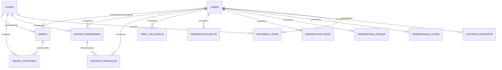

# 🏥 DOKUMENTASI SISTEM INFORMASI e-POSYANDU

<p align="center">
  
  
  
  
  
</p>

> **Sistem Informasi Manajemen Pelayanan Kesehatan Terpadu Masyarakat Berbasis Web & REST API**  
> Terintegrasi untuk pemantauan siklus hidup (Balita, Ibu Hamil, Remaja, Lansia) dan siap terhubung dengan aplikasi mobile **Android (Kotlin Jetpack Compose)**.

---

## 📑 DAFTAR ISI
1. [Ringkasan & Tujuan Sistem](#1-ringkasan--tujuan-sistem)
2. [Arsitektur & Spesifikasi Teknologi](#2-arsitektur--spesifikasi-teknologi)
3. [Struktur Direktori Proyek](#3-struktur-direktori-proyek)
4. [Skema Basis Data & ERD (13 Tabel Lengkap)](#4-skema-basis-data--erd-13-tabel-lengkap)
5. [Daftar Akun Default & Kredensial Pengujian](#5-daftar-akun-default--kredensial-pengujian)
6. [Panduan Instalasi & Menjalankan Proyek](#6-panduan-instalasi--menjalankan-proyek)
7. [Rincian & Urutan Seeder Database](#7-rincian--urutan-seeder-database)
8. [Fitur & Modul Utama Aplikasi Web](#8-fitur--modul-utama-aplikasi-web)
9. [Katalog Desain Status & Error Code (2xx, 4xx, 5xx)](#9-katalog-desain-status--error-code-2xx-4xx-5xx)
10. [Dokumentasi Lengkap 22 Endpoint REST API](#10-dokumentasi-lengkap-22-endpoint-rest-api)
11. [Perintah Artisan & Pemeliharaan Sistem](#11-perintah-artisan--pemeliharaan-sistem)

---

## 1. Ringkasan & Tujuan Sistem

**e-Posyandu** merupakan platform digital komprehensif yang dirancang untuk mendigitalkan seluruh pencatatan, pemantauan antropometri, dan pelaporan kegiatan Pos Pelayanan Terpadu (Posyandu). Sistem ini melayani seluruh tahapan siklus hidup manusia:

- **👶 Bayi & Balita (0–5 Tahun)**: Pemantauan tumbuh kembang (Berat Badan, Tinggi Badan, Lingkar Kepala, Lingkar Lengan Atas, Lingkar Perut), pencegahan stunting, pemantauan imunisasi dasar lengkap, serta penyaluran Vitamin A dan Pemberian Makanan Tambahan (PMT).
- **🤰 Ibu Hamil (ANC)**: Pemantauan usia kehamilan, berat badan, tekanan darah (tensi), skrining Kurang Energi Kronis (KEK) melalui pita LILA, dan deteksi dini kehamilan berisiko tinggi.
- **🧑 Remaja & Usia Produktif**: Skrining anemia, pemeriksaan Hemoglobin (Hb), tensi darah, serta distribusi Tablet Tambah Darah (TTD).
- **👴 Lansia (Posbindu PTM)**: Pemantauan Penyakit Tidak Menular (Hipertensi, Diabetes Melitus, Asam Urat), pemeriksaan fisik rutin, dan evaluasi berkala.
- **📦 Logistik & PMT**: Manajemen persediaan suplemen gizi, vitamin, obat-obatan, dan alat medis posyandu.
- **💰 Keuangan & Arus Kas**: Transparansi anggaran Alokasi Dana Desa (ADD), BOK Puskesmas, dan iuran operasional.

---

## 2. Arsitektur & Spesifikasi Teknologi

| Komponen | Teknologi | Deskripsi |
| :--- | :--- | :--- |
| **Backend Framework** | Laravel 11 / 12 | Framework PHP modern dengan arsitektur MVC |
| **Bahasa Pemrograman** | PHP 8.3 (CLI & Web) | Eksekusi cepat dengan tipe data terstruktur ketat |
| **Database Server** | MySQL 8.0 / MariaDB | Menggunakan engine InnoDB dengan relasi *Foreign Key* |
| **Web Server Lokal** | Laragon / Apache / Nginx | Mendukung virtual host otomatis `http://e-posyandu.test` |
| **Frontend Web** | Laravel Blade Engine | Antarmuka responsif tanpa dependensi framework berat |
| **REST API** | Native Laravel Route API | 22 endpoint JSON untuk klien mobile Android |
| **Mobile Client** | Kotlin Jetpack Compose | Siap dikonsumsi menggunakan Retrofit / Ktor |
| **Ikon & Desain** | Font Awesome 6.4 + Google Fonts | *Playfair Display* (Serif) & *Inter* (Sans-serif) |

---

## 3. Struktur Direktori Proyek

```plaintext
C:\laragon\www\e-Posyandu/
├── app/
│   ├── Http/
│   │   └── Controllers/
│   │       ├── Controller.php
│   │       ├── AdminController.php           # Kontroller dashboard, warga, logistik web
│   │       ├── StatusController.php          # Kontroller galeri kode status & error
│   │       └── Api/                          # KONTROLLER REST API MOBILE:
│   │           ├── BaseApiController.php     # Helper penyeragaman format JSON
│   │           ├── AuthController.php        # Endpoint autentikasi mobile
│   │           ├── DashboardController.php   # Endpoint ringkasan mobile home
│   │           ├── WargaController.php       # Endpoint CRUD data warga
│   │           ├── PemeriksaanController.php # Endpoint input antropometri siklus hidup
│   │           ├── JadwalController.php      # Endpoint jadwal kegiatan
│   │           ├── ProdukController.php      # Endpoint inventaris & PMT
│   │           └── ArtikelController.php     # Endpoint edukasi kesehatan
│   └── Models/
│       ├── User.php                          # Model Pimpinan, Admin, & Bidan
│       ├── Kader.php                         # Model Kader Posyandu
│       ├── Warga.php                         # Model Biodata Kependudukan Warga
│       ├── JadwalPosyandu.php                # Model Jadwal Kegiatan
│       ├── BarangManajemen.php               # Model Stok Barang & Logistik PMT
│       ├── LaporanPenjualan.php              # Model Distribusi & Pengeluaran Barang
│       ├── TabelKasMasuk.php                 # Model Arus Kas Masuk & Dana Posyandu
│       ├── PemeriksaanBalita.php             # Model Antropometri Balita
│       ├── PemeriksaanBumil.php              # Model Rekam Medis Ibu Hamil
│       ├── PemeriksaanRemaja.php             # Model Skrining Kesehatan Remaja
│       ├── PemeriksaanLansia.php             # Model Skrining PTM Lansia
│       ├── LaporanKesehatan.php              # Model Rekapitulasi Laporan Bulanan
│       └── InformasiUmum.php                 # Model Publikasi Edukasi & Artikel
├── database/
│   ├── migrations/                           # 13 berkas migrasi tabel skema database
│   └── seeders/                              # 11 berkas seeder data awal lengkap
│       └── DatabaseSeeder.php                # Master seeder orchestrator
├── public/                                   # Root publik aset web (css, js, images)
├── resources/
│   └── views/
│       ├── layouts/                          # Master template layout admin
│       ├── admin/                            # Tampilan halaman web admin
│       ├── errors/                           # Template halaman error otomatis (404, 500, dll.)
│       └── status/                           # Landing page galeri kode status interaktif
├── routes/
│   ├── web.php                               # Definisi rute antarmuka Web Admin
│   ├── api.php                               # Definisi 22 endpoint REST API Mobile
│   └── console.php                           # Definisi perintah artisan kustom
├── DOKUMENTASI.md                            # DOKUMEN TUNGGAL PANDUAN LENGKAP SISTEM
├── composer.json                             # Dependensi PHP & Framework Laravel
└── .env                                      # Konfigurasi database & environment lokal
```

---

## 4. Skema Basis Data & ERD (13 Tabel Lengkap)

### A. Diagram Relasi Antar-Tabel (ERD)



### B. Kamus Data Ringkas (13 Tabel)

1. **`users`**: Akun pimpinan, staf admin, dan bidan desa pembina (`id_user`, `nama`, `username`, `jabatan`, `password`).
2. **`kader`**: Akun kader posyandu di tingkat RT/RW/Dusun (`id_kader`, `nama_kader`, `username`, `password`).
3. **`warga`**: Data kependudukan sasaran (`NIK` PK, `nama_lengkap`, `tanggal_lahir`, `nama_ayah`, `jenis_kelamin`, `nama_ibu`, `status`, `id_user`, `id_kader`).
4. **`jadwal_posyandu`**: Agenda kegiatan posyandu (`id_jadwal`, `tanggal_pelaksanaan`, `kegiatan_pelaksanaan`, `status_pelaksanaan`, `id_kader`, `id_balita`).
5. **`barang_manajemen`**: Logistik PMT, vitamin, obat, alat medis (`id_barang`, `nama_barang`, `jumlah`, `tanggal_masuk`, `kategori`, `harga`, `id_kader`, `id_ketua`).
6. **`laporan_penjualan`**: Riwayat penyaluran/distribusi logistik (`id_penjualan`, `nominal`, `jumlah_barang`, `tanggal_keluar`, `total_harga`, `id_barang`, `id_ketua`).
7. **`tabel_kas_masuk`**: Pemasukan kas operasional desa & BOK (`id_laporan`, `total_dana_dikelola`, `status_laporan`, `tanggal_terima_dana`, `nama_sumber`, `ket_penggunaan_dana`, `id_ketua`).
8. **`pemeriksaan_balita`**: Antropometri balita (`id_periksa`, `tanggal`, `bb`, `tb`, `lk`, `la`, `lp`, `status`, `id_user`).
9. **`pemeriksaan_bumil`**: Pemeriksaan kehamilan ANC (`id_periksa`, `tanggal`, `usia_kehamilan`, `bb`, `tb`, `la`, `lp`, `tensi`, `status`, `id_user`).
10. **`pemeriksaan_remaja`**: Skrining remaja & Hb (`id_periksa`, `tanggal`, `bb`, `tb`, `tensi`, `hemoglobin`, `gula`, `status`, `id_user`).
11. **`pemeriksaan_lansia`**: Skrining PTM lansia (`id_periksa`, `tanggal`, `bb`, `tb`, `tensi`, `gula`, `riwayat_penyakit`, `status`, `id_user`).
12. **`laporan_kesehatan`**: Rekapitulasi laporan bulanan posyandu (`id_lap_kesehatan`, `jenis_laporan`, `tanggal_dibuat`, `id_periksa`, `id_ketua`).
13. **`informasi_umum`**: Artikel penyuluhan & pengumuman (`id_informasi`, `judul`, `isi_informasi`, `tanggal_post`, `kategori_info`, `gambar_poster`, `id_kader`, `id_ketua`).

---

## 5. Daftar Akun Default & Kredensial Pengujian

Seluruh akun default menggunakan kata sandi (*password*) yang seragam untuk memudahkan pengujian: **`password`**

### A. Pengguna Web Admin & Pimpinan (`users`)
| Nama Petugas | Username | Jabatan | Akses Utama |
| :--- | :--- | :--- | :--- |
| Dr. Hendra Kusuma | `ketua` | Ketua Posyandu | Pengawasan, Laporan Keuangan, & Validasi |
| Administrator Posyandu | `admin` | Administrator Sistem | Akses Penuh Sistem & Pengaturan |
| Bdn. Ratna Juwita, S.Tr.Keb | `bidan_desa` | Bidan Desa Pembina | Validasi ANC, Rujukan, & Imunisasi |
| Siti Nurhaliza, A.Md.Gz | `nutrisionis` | Petugas Gizi Puskesmas | Evaluasi Gizi Balita & Program Stunting |

### B. Akun Kader Posyandu (`kader`)
| Nama Kader | Username | Wilayah Tugas / Posko |
| :--- | :--- | :--- |
| Ibu Kader Anggrek | `kader1` | Pos Anggrek (Pos Utama) |
| Ibu Sri Wahyuni | `kader_mawar` | Pos Mawar (RW 01) |
| Ibu Siti Rahayu | `kader_melati` | Pos Melati (RW 02) |
| Ibu Endang Lestari | `kader_dahlia` | Pos Dahlia (RW 03) |

### C. Contoh NIK Warga untuk Pencarian / Login Mobile
| NIK (16 Digit) | Nama Warga | Kategori | Tanggal Lahir (Password Mobile) |
| :--- | :--- | :--- | :--- |
| `3201020304050001` | Aditya Pratama | Balita | `2023-01-15` |
| `3274012023080004` | Arlo Wijaya | Balita | `2022-06-14` |
| `3201021405230002` | Naura Kayla Az-Zahra | Balita | `2023-05-14` |
| `3201024508920005` | Siti Aminah | Ibu Hamil | `1995-08-20` |
| `3201025203970008` | Dewi Lestari Kusuma | Ibu Hamil | `1997-03-12` |
| `3201021804080003` | Dimas Arya Pratama | Remaja | `2008-04-18` |
| `3201021203550002` | Karto Wijoyo | Lansia | `1955-03-12` |
| `3201024807530007` | Hj. Sutinah | Lansia | `1953-07-08` |

---

## 6. Panduan Instalasi & Menjalankan Proyek

### A. Prasyarat Perangkat Lunak
- **Laragon** (atau XAMPP) dengan Apache/Nginx dan MySQL aktif.
- **PHP 8.2 atau 8.3**.
- **Composer 2.x**.

### B. Langkah Eksekusi

1. **Buka Terminal di Folder Proyek**:
   ```bash
   cd C:\laragon\www\e-Posyandu
   ```

2. **Periksa File Lingkungan (`.env`)**:
   Pastikan pengaturan basis data pada `.env` sudah mengarah ke database lokal Anda:
   ```env
   DB_CONNECTION=mysql
   DB_HOST=127.0.0.1
   DB_PORT=3306
   DB_DATABASE=e-posyandu
   DB_USERNAME=root
   DB_PASSWORD=
   ```

3. **Install Dependensi Paket (Bila Pertama Kali)**:
   ```bash
   composer install
   ```

4. **Jalankan Migrasi Database & Seeder Sekaligus**:
   ```bash
   php artisan migrate:fresh --seed
   ```

5. **Jalankan Server Lokal**:
   ```bash
   php artisan serve
   ```
   Aplikasi siap diakses melalui peramban: **`http://localhost:8000`** atau virtual host Laragon **`http://e-posyandu.test`**.

---

## 7. Rincian & Urutan Seeder Database

Semua seeder dieksekusi secara otomatis dan berurutan oleh [`DatabaseSeeder.php`](file:///c:/laragon/www/e-Posyandu/database/seeders/DatabaseSeeder.php) untuk menjaga integritas relasi *Foreign Key*:

```mermaid
flowchart LR
    U["1. UserSeeder"] --> K["2. KaderSeeder"]
    K --> W["3. WargaSeeder"]
    W --> J["4. JadwalSeeder"]
    J --> B["5. BarangSeeder"]
    B --> LP["6. PenjualanSeeder"]
    LP --> KM["7. KasMasukSeeder"]
    KM --> P["8. PemeriksaanSeeder"]
    P --> LK["9. LaporanSeeder"]
    LK --> I["10. InformasiSeeder"]
```



| Nama Seeder | Entitas Model | Jumlah Data | Keterangan Data |
| :--- | :--- | :--- | :--- |
| `UserSeeder` | `User` | 4 Akun | Ketua Posyandu, Admin, Bidan Desa, Nutrisionis |
| `KaderSeeder` | `Kader` | 4 Akun | Kader berbagai posko (Anggrek, Mawar, Melati, Dahlia) |
| `WargaSeeder` | `Warga` | 13 Warga | Balita (4), Ibu Hamil (3), Remaja (3), Lansia (3) |
| `JadwalPosyanduSeeder` | `JadwalPosyandu` | 5 Jadwal | Penimbangan, imunisasi, posbindu, kelas ibu hamil |
| `BarangManajemenSeeder` | `BarangManajemen` | 9 Produk | PMT, Vitamin A Biru/Merah, TTD, Oralit, alat ukur (ada stok 0) |
| `LaporanPenjualanSeeder` | `LaporanPenjualan` | 3 Transaksi | Distribusi logistik PMT dan vitamin ke masyarakat |
| `TabelKasMasukSeeder` | `TabelKasMasuk` | 4 Riwayat | Alokasi Dana Desa (ADD), BOK, Swadaya warga, CSR |
| `PemeriksaanSeeder` | `Pemeriksaan*` | 11 Pemeriksaan | Rekam medis antropometri lengkap dengan status klinis |
| `LaporanKesehatanSeeder` | `LaporanKesehatan` | 4 Rekap | Rekapitulasi bulanan gizi balita, ANC, PTM, anemia |
| `InformasiUmumSeeder` | `InformasiUmum` | 5 Artikel | Edukasi 1000 HPK, Menu 4 Bintang MPASI, Imunisasi, Lansia |

---

## 8. Fitur & Modul Utama Aplikasi Web

1. **Modul Autentikasi (`/` atau `/login`)**: Antarmuka login bertema kesehatan dengan tombol interaktif tampilkan/sembunyikan kata sandi.
2. **Dashboard Statistik (`/admin/dashboard`)**: Menghitung otomatis total warga per kelompok usia (`Balita`, `Ibu Hamil`, `Lansia`, `Remaja`) dan daftar pendaftaran terbaru secara real-time.
3. **Pendaftaran Anggota (`/admin/pendaftaran`)**: Registrasi warga baru dengan validasi 16 digit NIK unik, retensi nilai input `old('...')`, serta proteksi nilai kosong.
4. **Daftar & Pencarian Anggota (`/admin/daftar-anggota`)**: Fitur pencarian NIK/nama, filter cepat semua kategori (*Semua, Balita, Ibu Hamil, Remaja, Lansia*), dan paginasi rapi.
5. **Detail Profil Warga (`/admin/profil/{nik}`)**: Menampilkan biodata lengkap dinamis, riwayat antropometri, dan tombol langsung menuju formulir pemeriksaan baru.
6. **Pencatatan Fisik & Antropometri (`/admin/pemeriksaan`)**: Formulir input TB, BB, LK, LA, dan catatan kesehatan dengan identifikasi subjek otomatis.
7. **Manajemen Produk & Logistik PMT (`/admin/manajemen-produk`)**: Monitoring ketersediaan suplemen gizi, deteksi stok habis, dan modal input produk baru.
8. **Laporan Keuangan (`/admin/laporan-keuangan`)**: Rekapitulasi dana kas masuk, total pengeluaran bantuan, dan sisa saldo kas operasional.
9. **Laporan Kesehatan Bulanan (`/admin/laporan-kesehatan`)**: Rekapitulasi kegiatan posyandu dan riwayat cetak berkas laporan.
10. **Manajemen Artikel Edukasi (`/admin/manajemen-artikel`)**: Editor materi penyuluhan stunting, MPASI, dan imunisasi yang langsung tampil di daftar artikel aktif.

---

## 9. Katalog Desain Status & Error Code (2xx, 4xx, 5xx)

Sistem telah dilengkapi desain halaman responsif untuk seluruh variasi status kode HTTP:

- **Landing Page Interaktif**: Akses di **`http://localhost:8000/status`** (disediakan switcher instan tanpa reload untuk menguji seluruh kode).
- **Penanganan Error Otomatis**: Berkas pada `resources/views/errors/` otomatis aktif saat terjadi eror di Laravel:
  - `404.blade.php`: Halaman / Rekam Medis Tidak Ditemukan
  - `403.blade.php`: Akses Dibatasi Khusus Bidan/Ketua
  - `401.blade.php`: Sesi Masuk Diperlukan / Belum Login
  - `419.blade.php`: Sesi Formulir Kedaluwarsa (Token CSRF Habis)
  - `429.blade.php`: Batas Akses Terlampaui (*Rate Limiting*)
  - `500.blade.php`: Gangguan Teknis Server Internal
  - `503.blade.php`: Pemeliharaan Berkala Layanan (*Maintenance Mode*)

---

## 10. Dokumentasi Lengkap 22 Endpoint REST API

REST API disatukan di dalam Laravel ([`routes/api.php`](file:///c:/laragon/www/e-Posyandu/routes/api.php)) agar klien mobile Android (Kotlin Jetpack Compose) berbagi database dan validasi yang sama dengan web.

### A. Alamat Dasar (Base URL)
- **Android Studio Emulator**: `http://10.0.2.2:8000/api/`
- **Device Fisik Android (WiFi/LAN)**: `http://[IP-Komputer]:8000/api/`
- **Server Produksi / Hosting**: `https://domain-posyandu.com/api/`

### B. Format Standar Respons JSON

#### Respons Berhasil (`HTTP 200 / 201`):
```json
{
  "success": true,
  "message": "Data berhasil diambil",
  "data": { ... }
}
```

#### Respons Gagal / Validasi (`HTTP 422 / 401 / 404`):
```json
{
  "success": false,
  "message": "Validasi formulir pendaftaran gagal.",
  "errors": [
    "NIK harus terdiri dari 16 digit.",
    "Tanggal lahir wajib ditentukan."
  ]
}
```

---

### C. Katalog 22 Endpoint REST API

#### 1. Autentikasi (`/api/auth`)
| Method | Endpoint | Fungsi | Payload JSON Body |
| :--- | :--- | :--- | :--- |
| `POST` | `/api/auth/login` | Login Petugas, Kader, atau Warga | `{"username": "kader1", "password": "password"}` |
| `POST` | `/api/auth/logout` | Mengakhiri sesi login mobile | Kosong |

#### 2. Dashboard Mobile (`/api/dashboard`)
| Method | Endpoint | Fungsi | Keterangan |
| :--- | :--- | :--- | :--- |
| `GET` | `/api/dashboard` | Ringkasan statistik & jadwal terdekat | Mengembalikan jumlah balita, bumil, lansia, jadwal, dan stok kritis |

#### 3. Manajemen Warga (`/api/warga`)
| Method | Endpoint | Fungsi | Query / Body Payload |
| :--- | :--- | :--- | :--- |
| `GET` | `/api/warga` | Daftar seluruh warga (paginasi) | Query: `?search=nama&status=Balita&page=1` |
| `GET` | `/api/warga/{nik}` | Detail biodata warga lengkap | Parameter path `{nik}` |
| `POST` | `/api/warga` | Registrasi warga baru dari HP | `{"NIK":"3201...", "nama_lengkap":"...", "tanggal_lahir":"2023-01-01", "jenis_kelamin":"Laki-laki", "status":"Balita", "nama_ibu":"...", "nama_ayah":"..."}` |
| `PUT` | `/api/warga/{nik}` | Perbarui data warga | Field yang diperbarui dalam format JSON |

#### 4. Pencatatan Fisik & Antropometri (`/api/pemeriksaan`)
| Method | Endpoint | Fungsi | Payload Utama |
| :--- | :--- | :--- | :--- |
| `POST` | `/api/pemeriksaan/balita` | Input pertumbuhan balita | `{"tb": 85.5, "bb": 11.2, "lk": 46.0, "la": 14.5, "lp": 44.0, "tanggal": "2024-11-01"}` |
| `GET` | `/api/pemeriksaan/balita` | Riwayat pemeriksaan balita | Riwayat 20 pencatatan antropometri terakhir |
| `POST` | `/api/pemeriksaan/bumil` | Input pemeriksaan ANC bumil | `{"usia_kehamilan": "Trimester 2 (24 Minggu)", "bb": 62.0, "tensi": "115/75", "la": 24.5}` |
| `GET` | `/api/pemeriksaan/bumil` | Riwayat pemeriksaan ibu hamil | Riwayat 20 pencatatan bumil terakhir |
| `POST` | `/api/pemeriksaan/remaja` | Input skrining remaja & anemia | `{"tb": 158.0, "bb": 48.0, "hemoglobin": 12.8, "tensi": "110/70"}` |
| `GET` | `/api/pemeriksaan/remaja` | Riwayat skrining remaja | Riwayat 20 skrining remaja terakhir |
| `POST` | `/api/pemeriksaan/lansia` | Input pemeriksaan lansia & PTM | `{"bb": 60.0, "tensi": "130/80", "gula": 115.0, "riwayat_penyakit": "Asam urat terkontrol"}` |
| `GET` | `/api/pemeriksaan/lansia` | Riwayat pemeriksaan lansia | Riwayat 20 pemeriksaan lansia terakhir |

#### 5. Jadwal Posyandu (`/api/jadwal`)
| Method | Endpoint | Fungsi | Keterangan |
| :--- | :--- | :--- | :--- |
| `GET` | `/api/jadwal` | Daftar jadwal kegiatan posyandu | Query opsional: `?status=belum` atau `?status=selesai` |
| `GET` | `/api/jadwal/{id}` | Detail jadwal kegiatan | Parameter path ID jadwal |
| `POST` | `/api/jadwal` | Buat jadwal kegiatan baru | `{"tanggal_pelaksanaan": "2024-11-15", "kegiatan_pelaksanaan": "Penimbangan Balita Serentak"}` |

#### 6. Logistik & PMT (`/api/produk`)
| Method | Endpoint | Fungsi | Keterangan |
| :--- | :--- | :--- | :--- |
| `GET` | `/api/produk` | Daftar stok barang, PMT & obat | Query opsional: `?kategori=Vitamin&search=biskuit` |
| `GET` | `/api/produk/{id}` | Detail stok dan harga barang | Menampilkan sisa unit dan kategori |

#### 7. Edukasi & Artikel Kesehatan (`/api/artikel`)
| Method | Endpoint | Fungsi | Keterangan |
| :--- | :--- | :--- | :--- |
| `GET` | `/api/artikel` | Daftar artikel kesehatan posyandu | Query opsional: `?kategori=Nutrisi&search=stunting` |
| `GET` | `/api/artikel/{id}` | Baca isi artikel lengkap | Parameter path ID artikel |

---

### D. Contoh Pemanggilan di Kotlin (Retrofit)

```kotlin
// Model Respons Generik
data class ApiResponse<T>(
    val success: Boolean,
    val message: String,
    val data: T? = null,
    val errors: List<String>? = null
)

// Antarmuka Retrofit
interface PosyanduApiService {
    @POST("auth/login")
    suspend fun login(@Body body: Map<String, String>): ApiResponse<Map<String, Any>>

    @GET("dashboard")
    suspend fun getDashboard(): ApiResponse<Map<String, Any>>

    @GET("warga")
    suspend fun getWarga(
        @Query("status") status: String? = null,
        @Query("search") search: String? = null
    ): ApiResponse<Map<String, Any>>

    @POST("pemeriksaan/balita")
    suspend fun submitPemeriksaanBalita(@Body body: Map<String, Any>): ApiResponse<Map<String, Any>>
}
```

---

## 11. Perintah Artisan & Pemeliharaan Sistem

| Perintah | Fungsi Pemeliharaan |
| :--- | :--- |
| `php artisan migrate:fresh --seed` | Mengosongkan database, membuat ulang seluruh tabel, dan mengisi data seeder lengkap |
| `php artisan db:seed` | Menjalankan seeder tanpa menghapus skema tabel yang sudah ada |
| `php artisan route:list` | Menampilkan seluruh daftar route Web dan REST API yang aktif |
| `php artisan optimize:clear` | Membersihkan cache konfigurasi, route, views, dan event |
| `php artisan serve` | Menjalankan web server lokal Laravel (`http://localhost:8000`) |

---
*Dokumen ini merupakan panduan tunggal resmi (*single source of documentation*) untuk perancangan, pengembangan, dan integrasi sistem e-Posyandu.*
