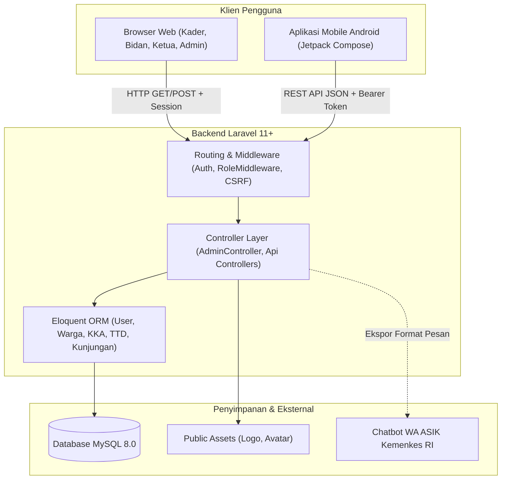
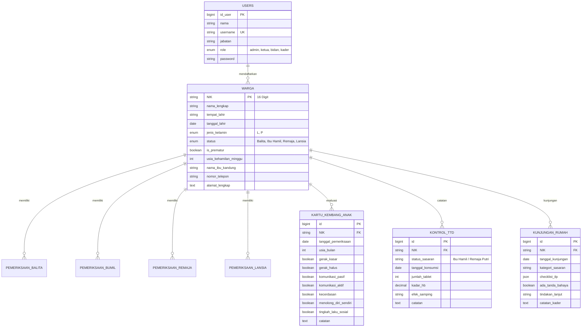
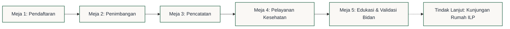
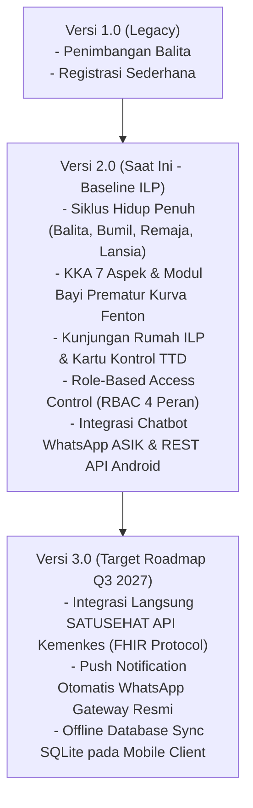

# PRODUCT REQUIREMENT DOCUMENT (PRD)
## SISTEM INFORMASI MANAJEMEN PELAYANAN KESEHATAN TERPADU MASYARAKAT (E-POSYANDU)
### Versi 2.0 — Integrasi Layanan Primer (ILP), KKA Digital, Modul Bayi Prematur, & Home Visit

---

| Parameter Dokumen | Spesifikasi Formal |
| :--- | :--- |
| **Nomor Dokumen** | `PRD-EPOSYANDU-2026-V2.0` |
| **Versi Produk** | 2.0.0 (Baseline Standar Kemenkes ILP) |
| **Tanggal Terbit** | 11 November 2026 |
| **Status Dokumen** | *Approved / Baseline Produksi* |
| **Penyusun** | Tim Engineering & Product Management e-Posyandu |
| **Pemilik Produk (Product Owner)** | Adi Darmawan |
| **Target Platform** | Web Dashboard (Laravel 11+ / Blade) & Mobile Client (Android Jetpack Compose / Retrofit) |
| **Basis Data** | MySQL 8.0+ |

---

## DAFTAR ISI

1. [Ringkasan Eksekutif & Visi Produk](#1-ringkasan-eksekutif--visi-produk)
2. [Latar Belakang & Pernyataan Masalah (Problem Statement)](#2-latar-belakang--pernyataan-masalah)
3. [Tujuan Produk & Indikator Kunci Keberhasilan (OKRs)](#3-tujuan-produk--indikator-kunci-keberhasilan-okrs)
4. [Analisis Pengguna & Persona (User Personas)](#4-analisis-pengguna--persona-user-personas)
5. [Matriks Hak Akses & Peran Sistem (RBAC Matrix)](#5-matriks-hak-akses--peran-sistem-rbac-matrix)
6. [Spesifikasi Kebutuhan Fungsional (Functional Requirements)](#6-spesifikasi-kebutuhan-fungsional)
   - [FR-01: Autentikasi Berbasis Peran & Manajemen Sesi](#fr-01-autentikasi-berbasis-peran--manajemen-sesi)
   - [FR-02: Manajemen Kependudukan & Pendaftaran Sasaran (NIK 16 Digit)](#fr-02-manajemen-kependudukan--pendaftaran-sasaran)
   - [FR-03: Pencatatan Fisik & Antropometri Multi-Siklus Hidup](#fr-03-pencatatan-fisik--antropometri-multi-siklus-hidup)
   - [FR-04: Modul Kartu Kembang Anak (KKA) 7 Aspek Kemenkes](#fr-04-modul-kartu-kembang-anak-kka-7-aspek-kemenkes)
   - [FR-05: Modul Bayi Prematur (Kurva Fenton & Usia Koreksi)](#fr-05-modul-bayi-prematur-kurva-fenton--usia-koreksi)
   - [FR-06: Modul Kartu Kontrol Tablet Tambah Darah (TTD)](#fr-06-modul-kartu-kontrol-tablet-tambah-darah-ttd)
   - [FR-07: Modul Kunjungan Rumah (Home Visit ILP) & Red Flag Deteksi](#fr-07-modul-kunjungan-rumah-home-visit-ilp--red-flag-deteksi)
   - [FR-08: Edukasi Gizi Masyarakat ("Isi Piringku", PHBS, CTPS)](#fr-08-edukasi-gizi-masyarakat-isi-piringku-phbs-ctps)
   - [FR-09: Laporan Kesehatan, Rekapitulasi Stunting & Chatbot WA ASIK](#fr-09-laporan-kesehatan-rekapitulasi-stunting--chatbot-wa-asik)
   - [FR-10: Pengaturan Akun, Keamanan 2FA & Konfigurasi Posko](#fr-10-pengaturan-akun-keamanan-2fa--konfigurasi-posko)
7. [Spesifikasi Kebutuhan Non-Fungsional (Non-Functional Requirements)](#7-spesifikasi-kebutuhan-non-fungsional)
8. [Arsitektur Teknis, ERD, & Integrasi API](#8-arsitektur-teknis-erd--integrasi-api)
9. [Alur Operasional Lapangan (Alur 5 Meja + Home Visit)](#9-alur-operasional-lapangan)
10. [Rencana Rilis, Manajemen Risiko & Roadmap Produk](#10-rencana-rilis-manajemen-risiko--roadmap-produk)

---

## 1. Ringkasan Eksekutif & Visi Produk

### 1.1 Visi Produk (Product Vision)
> *"Menjadi ekosistem digital pelayanan kesehatan primer terintegrasi nomor satu di tingkat desa/kelurahan, yang menghubungkan warga, kader lapangan, tenaga medis Puskesmas, dan pimpinan posko secara *real-time* berbasis standar Kemenkes RI untuk mengeliminasi risiko stunting dan meningkatkan derajat kesehatan seluruh siklus hidup masyarakat."*

### 1.2 Ringkasan Solusi
**e-Posyandu Versi 2.0** adalah evolusi menyeluruh dari sistem informasi posyandu tradisional. Mengacu pada agenda **Transformasi Layanan Primer (ILP) Kementerian Kesehatan RI**, platform ini tidak lagi hanya melayani penimbangan balita, melainkan mencakup seluruh siklus hidup manusia:
1. **Ibu Hamil & Menyusui**: Pemantauan ANC, LILA (skrining KEK), dan kontrol suplementasi 90 Tablet Tambah Darah (TTD).
2. **Bayi & Balita**: KMS digital, deteksi stunting/wasting, KKA (Kartu Kembang Anak 7 aspek), serta **penanganan komprehensif bayi prematur** dengan kurva pertumbuhan Fenton dan formula usia koreksi otomatis.
3. **Usia Sekolah & Remaja**: Skrining anemia remaja putri (kadar Hb dan distribusi TTD) serta edukasi gizi.
4. **Usia Produktif & Lansia**: Skrining Penyakit Tidak Menular (PTM) posbindu meliputi tekanan darah, asam urat, kolesterol, dan gula darah acak.
5. **Keluarga / Sasaran Lapangan**: Pelaporan Kunjungan Rumah (*Home Visit*) dengan format checklist standar ILP dan generator format Chatbot WhatsApp ASIK Kemenkes.

---

## 2. Latar Belakang & Pernyataan Masalah

### 2.1 Konteks Lapangan
Pada sistem posyandu manual yang berjalan saat ini, pengumpulan data kesehatan masyarakat memiliki kelemahan kritis:
* Buku KMS, KKA fisik, dan register kertas mudah rusak, basah, robek, atau terselip di rumah warga.
* Sering terjadi duplikasi identitas kependudukan akibat pencatatan nama panggilan yang tidak terikat pada NIK 16 digit.
* Data bayi lahir prematur kerap diukur menggunakan standar bayi cukup bulan (KMS WHO umum), menghasilkan diagnosis keliru *"gagal tumbuh / stunting palsu"* karena tidak memperhitungkan usia koreksi.
* Hasil Kunjungan Rumah (*home visit*) oleh kader tidak terdokumentasi terpusat, menyebabkan keterlambatan penanganan tanda bahaya (*red flag*).
* Rekapitulasi laporan bulanan ke Puskesmas dan pelaporan ke sistem nasional ASIK Kemenkes RI memakan waktu berhari-hari.

### 2.2 Pernyataan Masalah (Problem Statements)

| ID Masalah | Deskripsi Akar Permasalahan | Dampak Bisnis & Klinis |
| :--- | :--- | :--- |
| **PS-01** | Data identitas sasaran dan rekam antropometri tercecer pada buku register fisik. | Kesulitan melacak tren riwayat kesehatan individu saat sasaran berpindah posko atau berobat ke faskes rujukan. |
| **PS-02** | Tidak adanya otomasi perhitungan usia koreksi bayi prematur (< 37 minggu gestasi). | Salah evaluasi status gizi (bayi prematur divonis stunting padahal pertumbuhannya normal menurut usia koreksi Kurva Fenton). |
| **PS-03** | Rendahnya kepatuhan minum 90 Tablet Tambah Darah (TTD) pada Ibu Hamil dan Remaja Putri. | Risiko tinggi anemia defisiensi besi dan bayi berat lahir rendah (BBLR). |
| **PS-04** | Kunjungan Rumah ILP masih menggunakan formulir kertas manual tanpa validasi terpusat. | Temuan tanda bahaya (*red flag*) tidak segera tereskalasi ke Bidan Desa atau dokter Puskesmas. |
| **PS-05** | Akses masuk sistem web sebelumnya belum menerapkan kontrol peran berjenjang (*Role-Based Access Control*). | Risiko kebocoran data medis privasi dan tidak adanya audit kepemilikan aksi input data lapangan. |

---

## 3. Tujuan Produk & Indikator Kunci Keberhasilan (OKRs)

### 3.1 Tujuan Strategis (Product Goals)
1. **Digitalisasi Penuh**: Menggantikan buku register kertas dengan sistem pencatatan web responsif dan aplikasi mobile Android berbasis REST API.
2. **Kepatuhan Regulasi Kemenkes**: Menerapkan 100% parameter ILP, 7 aspek perkembangan anak KKA, kurva Fenton, dan distribusi TTD.
3. **Peringatan Dini (Early Warning System)**: Menghasilkan notifikasi instan untuk status BGM (*Bawah Garis Merah*), Stunting, LiLA KEK, dan tanda bahaya kunjungan rumah.
4. **Keamanan Data Pasien**: Mengunci hak akses dengan Role-Based Access Control (RBAC), hashing Bcrypt, perlindungan sesi multi-perangkat, dan opsi autentikasi dua faktor (2FA/TFA).

### 3.2 Indikator Keberhasilan (OKRs & Key Metrics)

| Objective (Tujuan) | Key Result (Hasil Terukur) | Target Waktu |
| :--- | :--- | :--- |
| **O1: Akurasi Data Kesehatan Sasaran** | **KR 1.1**: 100% sasaran terdaftar memiliki NIK 16 digit terverifikasi.<br/>**KR 1.2**: 0% kesalahan evaluasi stunting pada bayi prematur berkat otomasi Kurva Fenton. | Q1 2027 |
| **O2: Efisiensi Pelaporan & Rekapitulasi** | **KR 2.1**: Waktu penyusunan rekap laporan bulanan berkurang dari 4 hari menjadi < 5 menit.<br/>**KR 2.2**: Format laporan Chatbot WA ASIK siap dikirim dalam 1 kali klik. | Q1 2027 |
| **O3: Kepatuhan Konsumsi TTD & KKA** | **KR 3.1**: Kepatuhan konsumsi minimal 90 TTD pada bumil termonitor mencapai > 85%.<br/>**KR 3.2**: 100% balita di posko memiliki rekam jejak evaluasi 7 aspek KKA. | Q2 2027 |
| **O4: Keamanan & Aksesibilitas Sistem** | **KR 4.1**: 0 insiden kebocoran data dengan pembatasan hak akses 4 peran (RBAC).<br/>**KR 4.2**: Tingkat ketersediaan sistem (*uptime*) mencapai 99.8%. | Sepanjang Operasional |

---

## 4. Analisis Pengguna & Persona (User Personas)

### Persona 1: Ibu Kader Lapangan (Primary Operator)
* **Nama**: Ibu Kader Rahmawati (42 Tahun)
* **Peran Sistem**: `kader` (Kader Aktif Posko Anggrek RW 01)
* **Karakteristik**: Mahir menggunakan smartphone, teliti, berinteraksi langsung dengan warga setiap hari penimbangan.
* **Kebutuhan**:
  * Input cepat pendaftaran warga baru dengan form yang ramah pengguna.
  * Form pencatatan antropometri fisik yang ringkas tanpa reload halaman berlebih.
  * Checklist instan 7 aspek KKA dan formulir Kunjungan Rumah ILP.
* **Pain Points**: Bingung jika tampilan terlalu banyak teks teknis atau tombol bertumpuk; butuh antarmuka yang bersih, kontras warna jelas, dan bebas emoji membingungkan.

### Persona 2: Bidan Desa Pembina (Clinical Validator)
* **Nama**: Bdn. Ratna Juwita, S.Tr.Keb (34 Tahun)
* **Peran Sistem**: `bidan` (Bidan Desa / Koordinator Puskesmas Pembantu)
* **Karakteristik**: Tenaga medis profesional, berfokus pada akurasi diagnosis, rujukan klinis, dan keselamatan ibu-anak.
* **Kebutuhan**:
  * Grafik pertumbuhan balita dengan benchmark WHO Median dan Kurva Fenton untuk prematur.
  * Evaluasi status LiLA < 23.5 cm (risiko KEK) dan anemia pada ibu hamil.
  * Akses cepat ke catatan evaluasi medis dan rujukan faskes saat ada tanda bahaya.
* **Pain Points**: Sulit memverifikasi apakah pengukuran balita prematur sudah disesuaikan dengan usia koreksi atau belum jika dilakukan secara manual.

### Persona 3: Ketua Posyandu / Koordinator Pustu (Supervisor)
* **Nama**: Dr. Hendra Kusuma (48 Tahun)
* **Peran Sistem**: `ketua` (Ketua Pos Pelayanan Terpadu)
* **Karakteristik**: Penanggung jawab legalitas, pengawasan operasional lapangan, dan sinkronisasi lintas sektor desa.
* **Kebutuhan**:
  * Dashboard agregat capaian partisipasi warga per bulan.
  * Rekapitulasi stunting, capaian distribusi TTD, dan hasil kunjungan rumah.
  * Pengesahan laporan resmi posyandu untuk diajukan ke Kepala Desa dan Dinas Kesehatan.
* **Pain Points**: Laporan manual sering terlambat disetorkan dan format tidak seragam antar RW.

### Persona 4: Administrator Sistem (System Admin)
* **Nama**: Administrator Posyandu (29 Tahun)
* **Peran Sistem**: `admin` (Pengelola Teknis Aplikasi)
* **Kebutuhan**: Konfigurasi posko posyandu, pengelolaan akun pengguna, manajemen konten artikel edukasi, pemeliharaan REST API, dan backup basis data.

### Persona 5: Warga Masyarakat (Mobile Client User)
* **Nama**: Aditya Pratama / Orang Tua Balita (28 Tahun)
* **Peran Sistem**: `warga` (Akses Mobile Android)
* **Kebutuhan**: Memantau grafik pertumbuhan anak (KMS Digital), mengecek riwayat KKA, jadwal posyandu berikutnya, dan membaca materi gizi "Isi Piringku".

---

## 5. Matriks Hak Akses & Peran Sistem (RBAC Matrix)

Sistem menerapkan **Role-Based Access Control (RBAC)** berjenjang melalui middleware [`RoleMiddleware.php`](file:///c:/laragon/www/e-Posyandu/app/Http/Middleware/RoleMiddleware.php) dan penguncian rute di [`routes/web.php`](file:///c:/laragon/www/e-Posyandu/routes/web.php).

| Modul & Fitur Sistem | `admin` (Admin) | `ketua` (Ketua) | `bidan` (Bidan) | `kader` (Kader) | `warga` (Mobile) |
| :--- | :---: | :---: | :---: | :---: | :---: |
| **Login & Autentikasi Web** | Akses Penuh | Akses Penuh | Akses Penuh | Akses Penuh | Khusus Mobile (NIK) |
| **Dashboard Statistik Utama** | Lihat Semua | Lihat Semua | Lihat Semua | Lihat Semua | Dashboard Ringkas |
| **Daftar Anggota & Profil Warga** | CRUD | Lihat Detail | Lihat & Catat Medis | CRUD | Hanya Profil Sendiri |
| **Pendaftaran Sasaran Baru (NIK)** | **CRUD** | Dibatasi (Read) | Dibatasi (Read) | **CRUD** | - |
| **Pemeriksaan Fisik Antropometri** | CRUD | Lihat Riwayat | **CRUD & Validasi** | **Input Lapangan** | Lihat KMS Riwayat |
| **Evaluasi 7 Aspek KKA** | CRUD | Lihat Riwayat | **Validasi Medis** | **Input Lapangan** | Lihat Hasil KKA |
| **Kurva Fenton Bayi Prematur** | Lihat | Lihat | **Analisis Klinis** | Input Data Gestasi | Lihat Kurva Anak |
| **Kartu Kontrol TTD Bumil/Remaja**| CRUD | Lihat Capaian | **Validasi Medis** | **Input Distribusi**| Cek Riwayat Minum |
| **Kunjungan Rumah (Home Visit)** | CRUD | **Evaluasi & Rekap** | **Rekomendasi Nakes**| **Input Form ILP** | - |
| **Laporan Kesehatan & Stunting** | Verifikasi ASIK | **Pengesahan Legal** | **Validasi Klinis** | Lihat Capaian | - |
| **Chatbot WhatsApp ASIK Generator**| Akses | Akses | Akses | Akses | - |
| **Manajemen Artikel "Isi Piringku"**| **CRUD Penuh** | Lihat | **Kontribusi Medis** | Kontribusi Konten | Baca Artikel |
| **Pengaturan Akun & Keamanan 2FA** | Profil Sendiri | Profil Sendiri | Profil Sendiri | Profil Sendiri | Ganti PIN Mobile |
| **Konfigurasi Posko Posyandu** | **Akses Penuh** | **Akses Penuh** | Dibatasi | Dibatasi | - |

---

## 6. Spesifikasi Kebutuhan Fungsional (Functional Requirements)

### FR-01: Autentikasi Berbasis Peran & Manajemen Sesi
* **Deskripsi**: Sistem mengotentikasi pengguna web melalui username dan password ber-hash Bcrypt, serta memetakan hak akses ke peran pengguna (`admin`, `ketua`, `bidan`, `kader`).
* **Aturan Bisnis & Validasi**:
  * Setiap percobaan login harus dilindungi token proteksi CSRF.
  * Input username tidak peka huruf besar/kecil (*case-insensitive*) dan dipangkas dari spasi berlebih.
  * Pengguna yang berhasil masuk memiliki sesi aktif yang meregenerasi Session ID untuk mencegah serangan *session fixation*.
  * Jika akun terdaftar pada tabel `kader` lama, sistem secara otomatis menyinkronkan data ke tabel `users` dengan `role: kader`.
  * Disediakan tombol jalan pintas peran demo (*quick-fill*) pada antarmuka login untuk memudahkan pengujian.
* **Kriteria Penerimaan (Acceptance Criteria)**:
  * *Given* pengguna belum memiliki sesi, *when* mengakses rute `/admin/*`, *then* sistem mengalihkan ke `/` (halaman login) dengan status HTTP 302.
  * *Given* pengguna memasukkan username dan password valid, *when* menekan "Masuk Sekarang", *then* sistem mengarahkan ke dashboard utama dengan pesan sukses selamat datang.
  * *Given* pengguna memilih menu keluar, *when* mengonfirmasi modal logout, *then* sistem membatalkan sesi dan menghapus cookie autentikasi.

---

### FR-02: Manajemen Kependudukan & Pendaftaran Sasaran (NIK 16 Digit)
* **Deskripsi**: Modul registrasi warga sasaran posyandu berdasarkan Nomor Induk Kependudukan (NIK) 16 digit resmi.
* **Aturan Bisnis & Validasi**:
  * `NIK` wajib berupa 16 digit angka numerik unik (Primary Key).
  * Kategori sasaran terbagi menjadi 4 kelompok: **Balita** (0-5 tahun), **Ibu Hamil**, **Remaja** (10-18 tahun), dan **Lansia** ($\ge 60$ tahun).
  * Menyediakan penanda status bayi prematur (`is_prematur`) dan kolom usia kehamilan saat lahir (`usia_kehamilan_minggu`).
* **Kriteria Penerimaan**:
  * Pendaftaran sasaran baru hanya dapat dieksekusi oleh peran `admin` dan `kader`.
  * Sistem menolak pendaftaran jika format NIK kurang atau lebih dari 16 digit, atau jika NIK telah terdaftar sebelumnya.

---

### FR-03: Pencatatan Fisik & Antropometri Multi-Siklus Hidup
* **Deskripsi**: Formulir pengukuran berkala kondisi fisik warga di Meja 2 & Meja 3 Posyandu.
* **Parameter Pengukuran**:
  * **Balita**: Berat Badan (kg), Tinggi/Panjang Badan (cm), Lingkar Kepala (cm), Lingkar Lengan Atas/LiLA (cm), Cara Pengukuran (Terlentang/Berdiri).
  * **Ibu Hamil**: Berat Badan (kg), Tekanan Darah (Sistolik/Diastolik mmHg), LiLA (cm, indikator KEK bila < 23.5 cm), Tinggi Fundus Uteri (TFU cm), Usia Kehamilan (Minggu).
  * **Remaja**: Berat Badan, Tinggi Badan, LiLA, Indeks Massa Tubuh (IMT), dan Kadar Hemoglobin (Hb gr/dl).
  * **Lansia**: Tekanan Darah, Gula Darah Sewaktu (mg/dl), Kolesterol Total (mg/dl), dan Asam Urat (mg/dl).
* **Kriteria Penerimaan**:
  * Sistem otomatis menghitung IMT ($BB / (TB/100)^2$) dan status gizi balita berdasarkan standar antropometri WHO.

---

### FR-04: Modul Kartu Kembang Anak (KKA) 7 Aspek Kemenkes
* **Deskripsi**: Pemantauan tahapan perkembangan balita usia 0 hingga 72 bulan mengikuti standar KKA BKKBN/Kemenkes RI.
* **7 Aspek yang Dievaluasi**:
  1. **Gerak Kasar**: Kemampuan motorik mengangkat kepala, tengkurap, duduk, merangkak, berdiri, berjalan, dan melompat.
  2. **Gerak Halus**: Kemampuan motorik meraih benda, menjepit balok, memegang alat tulis, menggambar.
  3. **Komunikasi Pasif**: Kemampuan menoleh ketika dipanggil, memahami mimik wajah, mengikuti perintah sederhana.
  4. **Komunikasi Aktif**: Kemampuan mengoceh (*babbling*), mengucapkan kata bermakna, bertanya, dan bercerita.
  5. **Kecerdasan / Kognitif**: Mengenal warna dasar, bentuk geometri, menyebutkan anggota tubuh, menghitung benda.
  6. **Menolong Diri Sendiri**: Kemampuan makan dan minum sendiri, melepas/memakai pakaian, kepatuhan *toilet training*.
  7. **Tingkah Laku Sosial**: Kemampuan bermain interaktif bersama teman sebaya, berbagi mainan, dan beradaptasi lingkungan luar.
* **Kriteria Penerimaan**:
  * Jika terdapat aspek perkembangan yang belum tercapai pada kelompok usianya, sistem otomatis memunculkan tanda waspada stimulasi lanjutan.

---

### FR-05: Modul Bayi Prematur (Kurva Fenton & Usia Koreksi)
* **Deskripsi**: Modul spesifik untuk memantau pertumbuhan bayi yang lahir sebelum usia kehamilan 37 minggu.
* **Rumus Usia Koreksi**:
  $$\text{Usia Koreksi} = \text{Usia Kronologis (Bulan)} - \left(\frac{40 - \text{Usia Kehamilan (Minggu)}}{4}\right)$$
* **Benchmark Kurva Pertumbuhan**:
  * Menggunakan **Kurva Pertumbuhan Fenton (Fenton Growth Chart)** sampai anak mencapai usia koreksi 24 bulan (2 tahun).
  * Setelah usia koreksi 2 tahun, grafik otomatis bertransisi menggunakan kurva standar WHO.
* **Kriteria Penerimaan**:
  * Pada halaman profil bayi prematur, grafik pertumbuhan secara otomatis menampilkan dua garis: **Garis Pertumbuhan Riil Berdasarkan Usia Koreksi** dan **Garis Median Benchmark Kurva Fenton**.

---

### FR-06: Modul Kartu Kontrol Tablet Tambah Darah (TTD)
* **Deskripsi**: Pencatatan suplementasi Tablet Tambah Darah (Fe + Asam Folat) untuk mencegah anemia defisiensi besi pada Ibu Hamil dan Remaja Putri.
* **Aturan Operasional**:
  * **Ibu Hamil**: Wajib mengonsumsi minimal **90 tablet** selama masa kehamilan. Form mencatat tanggal minum, jumlah tablet, keluhan efek samping (mual, sembelit, tinja gelap), dan evaluasi kadar Hb berkala.
  * **Remaja Putri**: Mengonsumsi 1 tablet setiap minggu di posko/sekolah.
* **Kriteria Penerimaan**:
  * Pada profil warga Ibu Hamil, sistem menyajikan progress bar pencapaian target 90 tablet lengkap dengan persentase kepatuhan.

---

### FR-07: Modul Kunjungan Rumah (Home Visit ILP) & Red Flag Deteksi
* **Deskripsi**: Pencatatan hasil pemantauan tatap muka langsung oleh kader ke rumah warga di luar hari buka posyandu.
* **Formulir Checklist Standar ILP**:
  * Kepemilikan jamban sehat dan akses air bersih layak minum.
  * Kepatuhan konsumsi PMT (Pemberian Makanan Tambahan) pemulihan gizi.
  * Kepatuhan minum obat/TTD secara teratur.
  * Deteksi Tanda Bahaya (*Red Flag*): demam tinggi $\ge 3$ hari, sesak napas, diare terus-menerus, batuk kronis, penurunan kesadaran, atau kejang.
* **Alur Penanganan Tanda Bahaya**:
  * Bila kader menandai adanya "Tanda Bahaya", sistem otomatis memberi badge status merah berkedip, menyarankan rujukan darurat ke Bidan Desa/Puskesmas, dan mengeskalasi catatan ke dashboard Ketua & Bidan.
* **Kriteria Penerimaan**:
  * Detail hasil kunjungan disajikan melalui modal dialog modern `#detailKunjunganModal` menggantikan `alert()` bawaan browser.

---

### FR-08: Edukasi Gizi Masyarakat ("Isi Piringku", PHBS, CTPS)
* **Deskripsi**: Pengelolaan panduan gizi dan materi penyuluhan kesehatan yang terhubung ke aplikasi mobile warga melalui REST API.
* **Standar Materi Pokok**:
  * **Pedoman Isi Piringku Kemenkes**: Komposisi 50% sayur & buah ($2/3$ sayur, $1/3$ buah) dan 50% karbohidrat & lauk ($2/3$ makanan pokok, $1/3$ lauk hewani/nabati).
  * **PHBS & CTPS**: 6 langkah Cuci Tangan Pakai Sabun pada air mengalir, konsumsi air 8 gelas/hari, dan aktivitas fisik 30 menit per hari.
* **Kriteria Penerimaan**:
  * Artikel yang dibuat oleh Admin/Bidan/Kader langsung dapat dibaca oleh warga di aplikasi Android melalui endpoint `GET /api/artikel`.

---

### FR-09: Laporan Kesehatan, Rekapitulasi Stunting & Chatbot WA ASIK
* **Deskripsi**: Rekapitulasi data capaian kesehatan bulanan untuk keperluan pelaporan internal desa dan integrasi ke platform ASIK (Aplikasi Sehat Indonesiaku) Kemenkes.
* **Fitur Generator Chatbot WhatsApp ASIK**:
  * Sistem menghasilkan format teks pelaporan standar terstruktur:
    ```text
    #REKAP_POSYANDU_BULANAN#
    POSKO: POS_ANGGREK_RW01
    PERIODE: November 2026
    TOTAL_SASARAN: 13
    KUNJUNGAN_BALITA: 42
    BALITA_T_NAIK: 38
    BALITA_BGM_STUNTING: 4
    ANC_BUMIL_TERPERIKSA: 12
    BUMIL_KEK: 1
    TTD_BUMIL_TERDISTRIBUSI: 85
    STATUS_VERIFIKASI: VALID_BIDAN_DESA
    ```
  * Dilengkapi tombol satu-klik *"Salin Teks ke Clipboard"* untuk memudahkan pengiriman via WhatsApp Web / smartphone ke nomor bot resmi Kemenkes.

---

### FR-10: Pengaturan Akun, Keamanan 2FA & Konfigurasi Posko
* **Deskripsi**: Pengelolaan kredensial akun pengguna, aktivasi autentikasi ganda (Google Authenticator), dan pengaturan identitas pos pelayanan.
* **Fitur**:
  * Pengubahan nama lengkap, username, email posyandu, dan kata sandi dengan verifikasi kata sandi lama.
  * Fitur 2FA: Tampilan SVG QR Code, kunci rahasia manual, input interaktif 6 kotak OTP, daftar kode pemulihan cadangan (*backup codes*), dan modal konfirmasi penonaktifan `#disableTfaModal`.
  * Fitur Logout Semua Sesi Lain: Membatalkan sesi perangkat lain yang terbuka.
  * Konfigurasi Posko Posyandu (khusus Admin & Ketua): Nama posko, RW, Desa, Bidan Pembina, dan nomor WhatsApp broadcast jadwal posyandu.

---

## 7. Spesifikasi Kebutuhan Non-Fungsional (Non-Functional Requirements)

### 7.1 Keamanan & Privasi Data Medis (Security)
* **Enkripsi Kata Sandi**: Menggunakan algoritma *Bcrypt* dengan cost factor $\ge 12$.
* **Proteksi Akses Terbuka**: Rute web `/admin/*` diwajibkan melewati proteksi autentikasi sesi dan pengecekan peran (`RoleMiddleware`).
* **CSRF Protection**: Seluruh request form HTTP POST/PUT/DELETE wajib menyertakan token CSRF valid.
* **Autentikasi Dua Faktor (2FA)**: Berbasis RFC 6238 TOTP (*Time-Based One-Time Password*) 30 detik.
* **Pencegahan SQL Injection**: Penggunaan Laravel Eloquent ORM dan PDO prepared statements pada seluruh query basis data.

### 7.2 Kinerja & Kecepatan Akses (Performance)
* **Waktu Muat Halaman**: Rerata rendering halaman web $< 400\text{ms}$ pada jaringan lokal / internet standar.
* **Waktu Respon REST API**: Rerata waktu respon API mobile $< 250\text{ms}$.
* **Optimasi Query**: Penggunaan *eager loading* (`with()`) untuk mencegah masalah $N+1$ query pada relasi warga dan pemeriksaan.
* **Template Caching**: Seluruh Blade template di-cache melalui `php artisan view:cache` pada lingkungan produksi.

### 7.3 Ketersediaan & Keandalan (Reliability)
* **Ketersediaan Layanan**: Target *uptime* $\ge 99.8\%$ dalam periode operasional tahunan.
* **Integritas Transaksi**: Eksekusi penyimpanan rekam medis dan data warga menggunakan database transaction (`DB::transaction`) untuk memastikan *atomicity*.

### 7.4 Standar Desain UI/UX (User Experience Standards)
* **Pedoman Zero-Emoji**: Tidak menggunakan karakter emoji pada antarmuka profesional. Seluruh penanda visual menggunakan tipografi bersih dan ikon vektor **FontAwesome 6**.
* **Palet Warna e-Posyandu**:
  * *Primary Color*: Deep Forest Green (`#2d6a4f` / `#1b4332`) melambangkan kesehatan dan pelayanan ramah lingkungan.
  * *Canvas Background*: Warm Cream Canvas (`#fbf9f4`) dan kartu berlatar putih bersih (`#ffffff`) dengan garis tepi halus (`#ede8de` / `#ebe6dd`).
  * *Tipografi*: Kombinasi font judul berwibawa **Playfair Display Serif** dan font isi **Inter Sans-Serif** yang memiliki tingkat keterbacaan tinggi.
* **Pop-Up Dialog Modern**: Menggantikan `alert()` dan `confirm()` native browser dengan dialog kustom `.modal-overlay > .modal-box` berlatar *frosted glass backdrop blur*, sudut membulat 20px, tombol tutup melingkar berotasi, dan aksi berbentuk *rounded pill*.
* **Mobile Responsiveness**: Tampilan antarmuka otomatis menyesuaikan dari layar desktop ($\ge 1200\text{px}$), tablet ($768\text{px} - 1024\text{px}$), hingga smartphone ($\le 640\text{px}$) dengan drawer navigasi samping yang halus.

---

## 8. Arsitektur Teknis, ERD, & Integrasi API

### 8.1 Arsitektur Perangkat Lunak
Sistem dibangun menggunakan arsitektur **Model-View-Controller (MVC)** berbasis framework PHP modern **Laravel 11+** dengan modularitas RESTful API untuk klien mobile.



### 8.2 Skema Entitas Basis Data (14 Tabel Inti)



### 8.3 Rincian Endpoint REST API Mobile Android

Aplikasi menyediakan **22 Endpoint REST API** lengkap berformat standar JSON:
* `POST /api/login` & `POST /api/logout` : Autentikasi token multi-peran (Petugas & Warga NIK).
* `GET /api/warga` & `GET /api/warga/{nik}` : Data kependudukan sasaran posyandu.
* `GET /api/pemeriksaan/balita/{nik}` : Rekam antropometri & pertumbuhan anak.
* `GET /api/pemeriksaan/bumil/{nik}` : Rekam ANC & evaluasi LiLA ibu hamil.
* `GET /api/kka/{nik}` & `POST /api/kka` : Evaluasi 7 aspek perkembangan anak KKA.
* `GET /api/kontrol-ttd/{nik}` & `POST /api/kontrol-ttd` : Pemantauan suplementasi TTD.
* `GET /api/kunjungan-rumah` & `POST /api/kunjungan-rumah` : Data formulir home visit ILP.
* `GET /api/artikel` & `GET /api/artikel/{id}` : Feed artikel materi gizi "Isi Piringku".
* `GET /api/jadwal` : Jadwal posyandu buka dan lokasi posko.

---

## 9. Alur Operasional Lapangan

### 9.1 Alur 5 Meja Posyandu Terintegrasi Digital



1. **Meja 1 (Pendaftaran - Kader)**: Kader memindai atau mencari NIK 16 digit warga di menu [Daftar Anggota](file:///c:/laragon/www/e-Posyandu/resources/views/admin/daftar-anggota.blade.php). Bila belum terdaftar, didaftarkan pada menu [Pendaftaran](file:///c:/laragon/www/e-Posyandu/resources/views/admin/pendaftaran.blade.php).
2. **Meja 2 (Penimbangan & Pengukuran - Kader)**: Penimbangan berat badan menggunakan timbangan digital tera resmi, pengukuran tinggi badan dengan stadiometer/infantometer, dan pengukuran LiLA pita merah-kuning-hijau.
3. **Meja 3 (Pencatatan - Kader)**: Penginputan hasil ukur ke sistem [Pencatatan Fisik](file:///c:/laragon/www/e-Posyandu/resources/views/admin/pemeriksaan.blade.php). Sistem otomatis menghitung Z-score, kurva pertumbuhan, usia koreksi bayi prematur, dan evaluasi 7 aspek KKA.
4. **Meja 4 (Pelayanan Kesehatan & PMT - Kader & Nakes)**: Pembagian PMT pemulihan lokal berstandar *Isi Piringku*, suplementasi Vitamin A, obat cacing, dan distribusi Tablet Tambah Darah (TTD).
5. **Meja 5 (Edukasi & Validasi Medis - Bidan Desa)**: Bidan mengecek alert stunting, memvalidasi tanda bahaya (*red flag*), memberikan konseling gizi, dan menerbitkan rujukan faskes jika diperlukan.
6. **Lanjutan Lapangan (Kunjungan Rumah ILP - Kader)**: Terhadap sasaran yang mangkir, balita stunting, bumil KEK, atau lansia dengan komorbid berat, kader melakukan kunjungan rumah terjadwal dan menginputkan checklist pemantauan.

---

## 10. Rencana Rilis, Manajemen Risiko & Roadmap Produk

### 10.1 Manajemen Risiko & Strategi Mitigasi

| Risiko Potensial | Dampak | Probabilitas | Rencana Mitigasi |
| :--- | :---: | :---: | :--- |
| **Koneksi internet tidak stabil di lokasi posko pelosok.** | Sedang | Tinggi | Optimasi cache lokal pada browser dan arsitektur *offline-first sync* pada aplikasi mobile Android. |
| **Kader senior kesulitan mengoperasikan form digital.** | Sedang | Sedang | Desain antarmuka *low-cognitive load*: form ringkas, kontras warna tinggi, zero-emoji, dan bimbingan simulasi peran demo. |
| **Data bayi prematur salah input usia kehamilan.** | Tinggi | Rendah | Validasi ketat pada form pendaftaran: rentang usia kehamilan dibatasi 24-42 minggu dengan tooltip penjelasan. |
| **Perubahan format pelaporan sistem nasional ASIK Kemenkes.** | Sedang | Sedang | Modul generator Chatbot WA ASIK dirancang modular berbasis template string sehingga mudah disesuaikan bila format Kemenkes berubah. |

### 10.2 Roadmap Pengembangan Produk



---

## 11. Pengesahan Dokumen

Dokumen Product Requirement Document (PRD) Versi 2.0 ini disahkan secara resmi sebagai acuan mutlak implementasi arsitektur perangkat lunak, verifikasi pengujian fungsionalitas, dan standar operasional pelayanan posyandu terpadu masyarakat.

*Ditetapkan di: Kabupaten Ciamis, Jawa Barat*  
*Tanggal: 11 November 2026*  

**Tim Pengembang & Pemilik Produk:**  
**Fahreza Akbar Maulana**  
*Lead Product Engineer *
**Adi Darmawan**  
*System Architect e-Posyandu*

