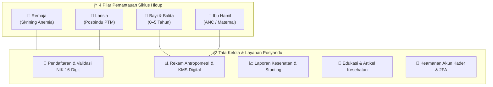
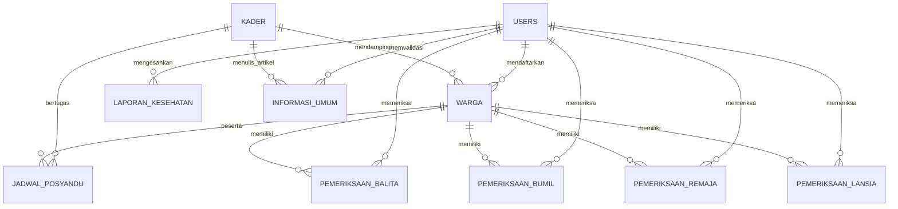
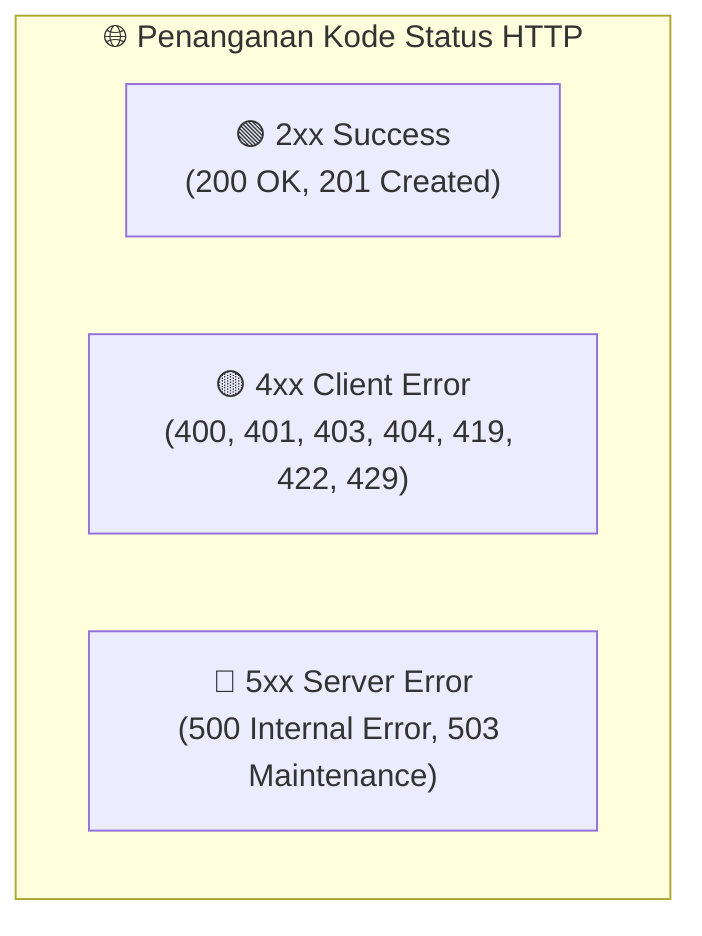

<div align="center">

# 🏥 E-POSYANDU
### *Sistem Informasi Manajemen Pelayanan Kesehatan Terpadu Masyarakat*

[](https://laravel.com)
[](https://php.net)
[](https://mysql.com)
[](#10-dokumentasi-lengkap-22-endpoint-rest-api)
[](#11-integrasi-mobile-client-kotlin-jetpack-compose--retrofit)
[](LICENSE)

<br/>

<p align="center">
  <b>Aplikasi Web Manajemen Posyandu Modern Terintegrasi REST API untuk Klien Mobile Android</b><br/>
  Fokus Utama pada Pengelolaan Data Warga & Kesehatan Siklus Hidup: Balita, Ibu Hamil, Remaja, Lansia, Rekam Medis KMS Digital, Edukasi Masyarakat, dan Pengaturan Keamanan Akun 2FA.
</p>

[🚀 Panduan Instalasi](#6-panduan-instalasi--menjalankan-proyek) •
[🔑 Akun Pengujian](#5-daftar-akun-default--kredensial-pengujian) •
[🗄️ Skema Database](#4-skema-basis-data--erd-13-tabel-lengkap) •
[🔌 Spesifikasi REST API](#10-dokumentasi-lengkap-22-endpoint-rest-api) •
[📱 Integrasi Android](#11-integrasi-mobile-client-kotlin-jetpack-compose--retrofit) •
[🎨 Desain Error Code](#9-katalog-desain-status--error-code-2xx-4xx-5xx)

---

</div>

## 📑 DAFTAR ISI

- [1. Ringkasan & Ruang Lingkup Sistem](#1-ringkasan--ruang-lingkup-sistem)
- [2. Arsitektur & Spesifikasi Teknologi](#2-arsitektur--spesifikasi-teknologi)
- [3. Struktur Direktori Proyek](#3-struktur-direktori-proyek)
- [4. Skema Basis Data & ERD (13 Tabel Lengkap)](#4-skema-basis-data--erd-13-tabel-lengkap)
  - [A. Entity Relationship Diagram (ERD)](#a-entity-relationship-diagram-erd)
  - [B. Kamus Data 13 Tabel](#b-kamus-data-13-tabel)
- [5. Daftar Akun Default & Kredensial Pengujian](#5-daftar-akun-default--kredensial-pengujian)
  - [A. Akun Web Admin & Tenaga Medis (Tabel: users)](#a-akun-web-admin--tenaga-medis-tabel-users)
  - [B. Akun Kader Posko Lapangan (Tabel: kader)](#b-akun-kader-posko-lapangan-tabel-kader)
  - [C. Sampel Data Warga & Login Mobile (Tabel: warga)](#c-sampel-data-warga--login-mobile-tabel-warga)
- [6. Panduan Instalasi & Menjalankan Proyek](#6-panduan-instalasi--menjalankan-proyek)
  - [A. Prasyarat Sistem](#a-prasyarat-sistem)
  - [B. Langkah Eksekusi Bertahap](#b-langkah-eksekusi-bertahap)
  - [C. Perintah Cepat (One-Liner Setup)](#c-perintah-cepat-one-liner-setup)
- [7. Rincian & Urutan Eksekusi Seeder Database](#7-rincian--urutan-eksekusi-seeder-database)
- [8. Fitur & Modul Utama Aplikasi Web](#8-fitur--modul-utama-aplikasi-web)
- [9. Katalog Desain Status & Error Code (2xx, 4xx, 5xx)](#9-katalog-desain-status--error-code-2xx-4xx-5xx)
  - [A. Simulator Kode Status Interaktif](#a-simulator-kode-status-interaktif)
  - [B. Pemetaan Tampilan Error Otomatis](#b-pemetaan-tampilan-error-otomatis)
- [10. Dokumentasi Lengkap 22 Endpoint REST API](#10-dokumentasi-lengkap-22-endpoint-rest-api)
  - [A. Konfigurasi Base URL](#a-konfigurasi-base-url)
  - [B. Standar Format Respons JSON](#b-standar-format-respons-json)
  - [C. Rincian 22 Endpoint REST API](#c-rincian-22-endpoint-rest-api)
- [11. Integrasi Mobile Client (Kotlin Jetpack Compose & Retrofit)](#11-integrasi-mobile-client-kotlin-jetpack-compose--retrofit)
  - [A. Dependensi Gradle (build.gradle.kts)](#a-dependensi-gradle-buildgradlekts)
  - [B. Interface Retrofit Service (PosyanduApiService.kt)](#b-interface-retrofit-service-posyanduapiservicekt)
  - [C. Client Retrofit Singleton (ApiClient.kt)](#c-client-retrofit-singleton-apiclientkt)
- [12. Perintah Artisan & Pemeliharaan Rutin](#12-perintah-artisan--pemeliharaan-rutin)

---

## 1. Ringkasan & Ruang Lingkup Sistem

Platform **e-Posyandu** dirancang untuk mendigitalkan tata kelola administrasi posyandu secara menyeluruh dari tingkat posko dusun/RT hingga puskesmas pembina, mencakup 4 pilar siklus hidup manusia:



| Siklus Sasaran | Indikator Pemantauan Utama | Intervensi & Layanan |
| :--- | :--- | :--- |
| **👶 Bayi & Balita** *(0–5 Thn)* | Berat Badan (BB), Tinggi Badan (TB), Lingkar Kepala (LK), LILA, Lingkar Perut | Deteksi dini stunting, imunisasi wajib, Vitamin A Biru/Merah, dan PMT Pemulihan |
| **🤰 Ibu Hamil** *(ANC)* | Usia gestasi, kenaikan BB, tensi darah, pita LILA (deteksi KEK) | Pencegahan Kematian Ibu/Bayi, tablet zat besi (TTD), dan rujukan risiko tinggi |
| **🧑 Remaja & Produktif** | Hemoglobin (Hb), tensi, Indeks Massa Tubuh (IMT), gula darah sewaktu | Pencegahan anemia remaja putri, tablet tambah darah (TTD), konseling gizi |
| **👴 Lansia** *(Posbindu PTM)* | Tensi darah (hipertensi), kadar gula darah (DM), asam urat, evaluasi fisik | Pengendalian penyakit tidak menular, pemeriksaan rutin, dan rujukan faskes |

[⬆️ Kembali ke Daftar Isi](#daftar-isi)

---

## 2. Arsitektur & Spesifikasi Teknologi

| Layer / Komponen | Teknologi | Keterangan & Peran |
| :--- | :--- | :--- |
| **Backend Core** | `Laravel 11 / 12` | Framework PHP dengan arsitektur MVC & routing terstruktur |
| **Bahasa Pemrograman** | `PHP 8.3` | Eksekusi cepat, *typed properties*, dan performa tinggi |
| **Basis Data** | `MySQL 8.0` / `MariaDB` | Engine InnoDB dengan integritas relasi *Foreign Key Constraint* |
| **Web Server** | `Laragon` / `Apache` / `Nginx` | Dukungan Virtual Host otomatis (`http://e-posyandu.test`) |
| **Frontend Web** | `Blade Templating Engine` | Tampilan responsif murni tanpa kompilasi build berat |
| **Antarmuka Mobile** | `Kotlin Jetpack Compose` | Siap dihubungkan ke 22 endpoint REST API JSON |
| **Koneksi Mobile HTTP** | `Retrofit 2` + `OkHttp 3` | Panggilan jaringan asynchronous dengan coroutine Kotlin |
| **Tipografi & Ikon** | `Font Awesome 6` + `Google Fonts` | Huruf *Playfair Display* & *Inter*, ikon medis modern |

[⬆️ Kembali ke Daftar Isi](#daftar-isi)

---

## 3. Struktur Direktori Proyek

```plaintext
e-Posyandu/
├── app/
│   ├── Http/
│   │   ├── Controllers/
│   │   │   ├── Controller.php               # Base Controller Laravel
│   │   │   ├── AdminController.php          # Controller Web: Dashboard, Pendaftaran, Anggota, Rekam Fisik, Laporan, Artikel, Profil, Pengaturan Akun (2FA)
│   │   │   ├── StatusController.php         # Controller Web: Simulator kode status & error page
│   │   │   └── Api/                         # KONTROLLER REST API (MOBILE CLIENT):
│   │   │       ├── BaseApiController.php    # JSON standard formatter helper
│   │   │       ├── AuthController.php       # POST /api/auth/login, logout
│   │   │       ├── DashboardController.php  # GET /api/dashboard
│   │   │       ├── WargaController.php      # GET, POST, PUT /api/warga
│   │   │       ├── PemeriksaanController.php# POST, GET /api/pemeriksaan/* (Balita, Bumil, Remaja, Lansia)
│   │   │       ├── JadwalController.php     # GET, POST /api/jadwal
│   │   │       ├── ProdukController.php     # GET /api/produk
│   │   │       └── ArtikelController.php    # GET /api/artikel
│   └── Models/                              # ELOQUENT ORM MODELS (13 Model):
│       ├── User.php                         # Akun Pimpinan, Admin, & Bidan
│       ├── Kader.php                        # Akun Kader Posko Lapangan
│       ├── Warga.php                        # Biodata Kependudukan (NIK sebagai PK)
│       ├── JadwalPosyandu.php               # Agenda Kegiatan Penimbangan & Posbindu
│       ├── BarangManajemen.php              # Logistik PMT, Suplemen, & Alat Medis
│       ├── LaporanPenjualan.php             # Riwayat Distribusi Bantuan & Obat
│       ├── TabelKasMasuk.php                # Laporan Alokasi Kas ADD, BOK, & Swadaya
│       ├── PemeriksaanBalita.php            # Rekam Antropometri Balita (BB, TB, LK, LA, LP)
│       ├── PemeriksaanBumil.php             # Rekam ANC Ibu Hamil (Tensi, LILA, Usia Hamil)
│       ├── PemeriksaanRemaja.php            # Skrining Remaja (Hb, Tensi, Gula)
│       ├── PemeriksaanLansia.php            # Skrining PTM Lansia (Tensi, Gula, Riwayat)
│       ├── LaporanKesehatan.php             # Rekapitulasi Laporan Bulanan Posyandu
│       └── InformasiUmum.php                # Publikasi Edukasi & Pengumuman Kesehatan
├── bootstrap/
│   └── app.php                              # Konfigurasi routing Web & API Laravel 11/12
├── database/
│   ├── migrations/                          # 13 skema berkas migrasi database
│   └── seeders/                             # 11 berkas seeder lengkap siap pakai
│       └── DatabaseSeeder.php               # Master orchestrator seeder
├── public/                                  # Root aset publik web (CSS, JS, assets)
├── resources/
│   └── views/
│       ├── layouts/                         # Master template Blade (`admin.blade.php`)
│       ├── admin/                           # Halaman aplikasi web admin & petugas
│       ├── errors/                          # Template respons error kustom (404, 403, 500, dll.)
│       └── status/                          # Landing page galeri kode status interaktif
├── routes/
│   ├── web.php                              # Definisi rute aplikasi web admin
│   ├── api.php                              # Definisi 22 endpoint REST API mobile
│   └── console.php                          # Rute perintah CLI / artisan
├── README.md                                # Dokumentasi utama repositori GitHub
├── composer.json                            # Konfigurasi dependensi PHP & Laravel
└── .env.example                             # Template konfigurasi environment
```

[⬆️ Kembali ke Daftar Isi](#daftar-isi)

---

## 4. Skema Basis Data & ERD (13 Tabel Lengkap)

### A. Entity Relationship Diagram (ERD)



### B. Kamus Data 13 Tabel

| No | Nama Tabel | Model Eloquent | Fungsi Entitas | Kolom Kunci (PK / FK) |
| :-: | :--- | :--- | :--- | :--- |
| 1 | `users` | `User` | Pimpinan posyandu, administrator, bidan desa, dan nutrisionis | **PK:** `id_user` |
| 2 | `kader` | `Kader` | Akun kader pendamping lapangan tiap posko posyandu | **PK:** `id_kader` |
| 3 | `warga` | `Warga` | Biodata kependudukan sasaran (Balita, Bumil, Remaja, Lansia) | **PK:** `NIK` (16 digit)<br/>**FK:** `id_user`, `id_kader` |
| 4 | `jadwal_posyandu` | `JadwalPosyandu` | Agenda kegiatan penimbangan, imunisasi, dan kelas bumil | **PK:** `id_jadwal`<br/>**FK:** `id_kader`, `id_balita` |
| 5 | `barang_manajemen` | `BarangManajemen` | Inventaris logistik PMT, vitamin, obat, dan alat medis | **PK:** `id_barang`<br/>**FK:** `id_kader`, `id_ketua` |
| 6 | `laporan_penjualan` | `LaporanPenjualan` | Riwayat distribusi dan pengeluaran bantuan logistik | **PK:** `id_penjualan`<br/>**FK:** `id_barang`, `id_ketua` |
| 7 | `tabel_kas_masuk` | `TabelKasMasuk` | Transparansi pemasukan kas (ADD Desa, BOK, CSR, Swadaya) | **PK:** `id_laporan`<br/>**FK:** `id_ketua` |
| 8 | `pemeriksaan_balita` | `PemeriksaanBalita` | Antropometri balita (BB, TB, Lingkar Kepala/Lengan/Perut) | **PK:** `id_periksa`<br/>**FK:** `id_user` |
| 9 | `pemeriksaan_bumil` | `PemeriksaanBumil` | Rekam medis ANC ibu hamil (LILA, tensi, usia gestasi) | **PK:** `id_periksa`<br/>**FK:** `id_user` |
| 10 | `pemeriksaan_remaja` | `PemeriksaanRemaja` | Skrining kesehatan remaja (Hb anemia, IMT, tensi darah) | **PK:** `id_periksa`<br/>**FK:** `id_user` |
| 11 | `pemeriksaan_lansia` | `PemeriksaanLansia` | Skrining Posbindu PTM lansia (tensi darah, gula, riwayat) | **PK:** `id_periksa`<br/>**FK:** `id_user` |
| 12 | `laporan_kesehatan` | `LaporanKesehatan` | Rekapitulasi laporan agregat bulanan posyandu | **PK:** `id_lap_kesehatan`<br/>**FK:** `id_periksa`, `id_ketua` |
| 13 | `informasi_umum` | `InformasiUmum` | Publikasi materi edukasi, artikel gizi, dan poster penyuluhan | **PK:** `id_informasi`<br/>**FK:** `id_kader`, `id_ketua` |

[⬆️ Kembali ke Daftar Isi](#daftar-isi)

---

## 5. Daftar Akun Default & Kredensial Pengujian

> [!TIP]
> **Kata Sandi Standar untuk Seluruh Akun**: Semua akun pengujian di bawah ini menggunakan kata sandi seragam: `password`.

### A. Akun Web Admin & Tenaga Medis (Tabel: users)

| Nama Pengguna | Username | Peran / Jabatan | Otoritas Akses Utama |
| :--- | :--- | :--- | :--- |
| **Dr. Hendra Kusuma** | `ketua` | Ketua Posyandu | Pengawasan menyeluruh, persetujuan keuangan, & pengesahan laporan |
| **Administrator Utama** | `admin` | Administrator Sistem | Akses penuh sistem, registrasi warga, logistik, & pemeliharaan |
| **Bdn. Ratna Juwita, S.Tr.Keb** | `bidan_desa` | Bidan Desa Pembina | Validasi ANC ibu hamil, rujukan medis, & imunisasi balita |
| **Siti Nurhaliza, A.Md.Gz** | `nutrisionis` | Petugas Gizi Puskesmas | Evaluasi status gizi antropometri balita & program stunting |

### B. Akun Kader Posko Lapangan (Tabel: kader)

| Nama Kader | Username | Wilayah Posko / Dusun | Keterangan Wilayah |
| :--- | :--- | :--- | :--- |
| **Ibu Kader Anggrek** | `kader1` | Pos Anggrek *(Posko Induk)* | Pos pelayanan utama desa |
| **Ibu Sri Wahyuni** | `kader_mawar` | Pos Mawar | Wilayah RW 01 |
| **Ibu Siti Rahayu** | `kader_melati` | Pos Melati | Wilayah RW 02 |
| **Ibu Endang Lestari** | `kader_dahlia` | Pos Dahlia | Wilayah RW 03 |

### C. Sampel Data Warga & Login Mobile (Tabel: warga)

Untuk pengujian aplikasi mobile Android, warga dapat masuk menggunakan **16 digit NIK** dan kata sandi berupa **Tanggal Lahir (Format: `YYYY-MM-DD`)**:

| NIK (Username Mobile) | Nama Lengkap Sasaran | Golongan Usia | Tanggal Lahir (PIN Masuk) |
| :---: | :--- | :---: | :---: |
| `3201020304050001` | **Aditya Pratama** | Balita | `2023-01-15` |
| `3274012023080004` | **Arlo Wijaya** | Balita | `2022-06-14` |
| `3201021405230002` | **Naura Kayla Az-Zahra** | Balita | `2023-05-14` |
| `3201024508920005` | **Siti Aminah** | Ibu Hamil | `1995-08-20` |
| `3201025203970008` | **Dewi Lestari Kusuma** | Ibu Hamil | `1997-03-12` |
| `3201021804080003` | **Dimas Arya Pratama** | Remaja | `2008-04-18` |
| `3201021203550002` | **Karto Wijoyo** | Lansia | `1955-03-12` |
| `3201024807530007` | **Hj. Sutinah** | Lansia | `1953-07-08` |

[⬆️ Kembali ke Daftar Isi](#daftar-isi)

---

## 6. Panduan Instalasi & Menjalankan Proyek

### A. Prasyarat Sistem
- **PHP** versi `8.2` atau `8.3` (dengan ekstensi `pdo_mysql`, `mbstring`, `openssl`, `bcmath` aktif).
- **Composer** versi `2.x`.
- **MySQL / MariaDB** (dapat menggunakan Laragon, XAMPP, atau Docker).
- **Git** terinstal pada sistem.

---

### B. Langkah Eksekusi Bertahap

#### 1. Masuk ke Direktori Proyek
```bash
cd C:\laragon\www\e-Posyandu
```

#### 2. Konfigurasi Lingkungan (`.env`)
Salin file template `.env.example` menjadi `.env` jika belum ada:
```bash
cp .env.example .env
```
Pastikan pengaturan koneksi basis data sesuai dengan MySQL lokal Anda:
```env
APP_NAME=e-Posyandu
APP_ENV=local
APP_KEY=base64:...
APP_DEBUG=true
APP_URL=http://localhost:8000

DB_CONNECTION=mysql
DB_HOST=127.0.0.1
DB_PORT=3306
DB_DATABASE=e-posyandu
DB_USERNAME=root
DB_PASSWORD=
```

#### 3. Instalasi Dependensi Composer
```bash
composer install
```

#### 4. Buat Application Key
```bash
php artisan key:generate
```

#### 5. Eksekusi Migrasi & Database Seeding
Jalankan migrasi skema tabel sekaligus mengisi data seeder lengkap:
```bash
php artisan migrate:fresh --seed
```

#### 6. Jalankan Server Web Lokal
```bash
php artisan serve
```
Aplikasi web siap diakses melalui peramban:
- **Aplikasi Web Admin**: [`http://localhost:8000`](http://localhost:8000) atau [`http://e-posyandu.test`](http://e-posyandu.test)
- **Katalog Galeri Error & Status Code**: [`http://localhost:8000/status`](http://localhost:8000/status)

---

### C. Perintah Cepat (One-Liner Setup)

Untuk pengaturan instan dalam satu baris perintah:
```bash
composer install && php artisan key:generate && php artisan migrate:fresh --seed && php artisan serve
```

[⬆️ Kembali ke Daftar Isi](#daftar-isi)

---

## 7. Rincian & Urutan Eksekusi Seeder Database

Semua data awal dikelola secara otomatis oleh `DatabaseSeeder.php` dengan urutan ketat untuk menjamin kepatuhan *Foreign Key*:

```mermaid
flowchart LR
    S1["1. UserSeeder"] --> S2["2. KaderSeeder"]
    S2 --> S3["3. WargaSeeder"]
    S3 --> S4["4. JadwalSeeder"]
    S4 --> S5["5. BarangSeeder"]
    S5 --> S6["6. PenjualanSeeder"]
    S6 --> S7["7. KasMasukSeeder"]
    S7 --> S8["8. PemeriksaanSeeder"]
    S8 --> S9["9. LaporanSeeder"]
    S9 --> S10["10. InformasiSeeder"]
```



| Nama File Seeder | Entitas Model | Jumlah Record | Spesifikasi Data yang Dihasilkan |
| :--- | :--- | :-: | :--- |
| `UserSeeder.php` | `User` | 4 Akun | Ketua posyandu, staf admin, bidan desa, dan ahli gizi |
| `KaderSeeder.php` | `Kader` | 4 Akun | Kader posko Pos Anggrek, Mawar, Melati, dan Dahlia |
| `WargaSeeder.php` | `Warga` | 13 Warga | 4 Balita, 3 Bumil, 3 Remaja, dan 3 Lansia dengan NIK valid |
| `JadwalPosyanduSeeder.php` | `JadwalPosyandu` | 5 Jadwal | Penimbangan serentak, imunisasi, posbindu, kelas ANC |
| `BarangManajemenSeeder.php` | `BarangManajemen` | 9 Logistik | Biskuit PMT, Vitamin A Merah/Biru, TTD, Oralit, alat medis |
| `LaporanPenjualanSeeder.php` | `LaporanPenjualan` | 3 Distribusi | Riwayat pengeluaran PMT & suplemen kepada warga |
| `TabelKasMasukSeeder.php` | `TabelKasMasuk` | 4 Pemasukan | Alokasi Dana Desa (ADD), BOK Puskesmas, Swadaya, CSR |
| `PemeriksaanSeeder.php` | `Pemeriksaan*` | 11 Rekam Medis | Antropometri balita (4), bumil (3), remaja (2), lansia (2) |
| `LaporanKesehatanSeeder.php` | `LaporanKesehatan` | 4 Laporan | Rekapitulasi bulanan status gizi, ANC, PTM, dan anemia |
| `InformasiUmumSeeder.php` | `InformasiUmum` | 5 Publikasi | Edukasi 1000 HPK, Menu MPASI 4 Bintang, Imunisasi, Lansia |

[⬆️ Kembali ke Daftar Isi](#daftar-isi)

---

## 8. Fitur & Modul Utama Aplikasi Web

Menu navigasi bilah sisi (*sidebar*) telah disederhanakan dan berfokus penuh pada **Pengelolaan Data Warga & Kesehatan Siklus Hidup**:

| Kategori Sidebar | Modul Web | URL Endpoint | Otoritas | Fitur & Fungsionalitas Utama |
| :--- | :--- | :--- | :--- | :--- |
| **Menu Utama** | **Dashboard Statistik** | `/admin/dashboard` | Admin / Kader | Ringkasan kartu real-time (balita, bumil, lansia, remaja), grafik kehadiran bulanan, tabel interaktif rincian kehadiran per kelompok usia, dan pendaftar terbaru |
| **Layanan Kesehatan** | **Pendaftaran Warga** | `/admin/pendaftaran` | Admin / Kader | Input registrasi warga baru dengan validasi 16 digit NIK & proteksi duplikasi data |
| **Layanan Kesehatan** | **Pemilihan Warga (Daftar Anggota)** | `/admin/daftar-anggota` | Admin / Petugas | Pemilihan warga interaktif, filter kategori (*Semua, Balita, Ibu Hamil, Dewasa & Remaja, Lansia*), pencarian instan nama/NIK, dan tautan langsung pencatatan |
| **Layanan Kesehatan** | **Pencatatan Fisik** | `/admin/pemeriksaan` | Bidan / Kader | Pencatatan antropometri (BB, TB, LiLA, LP, tensi darah) terhubung langsung ke NIK sasaran |
| **Layanan Kesehatan** | **Laporan Kesehatan** | `/admin/laporan-kesehatan`| Bidan / Ketua | Rekapitulasi capaian pelayanan bulanan, pemantauan risiko stunting, dan riwayat cetak rekap medis (PDF) |
| **Layanan Kesehatan** | **Artikel Edukasi** | `/admin/manajemen-artikel`| Admin / Kader | Publikasi materi penyuluhan stunting, gizi seimbang, MPASI, imunisasi, dan jadwal posyandu |
| **Layanan Kesehatan** | **Profil Warga** | `/admin/profil/{nik}` | Admin / Petugas | Rekam KMS digital, kartu identitas warga, grafik tumbuh kembang, dan riwayat pemeriksaan |
| **Keamanan & Posko** | **Pengaturan Akun & Posko** | `/admin/pengaturan-akun` | Kader / Petugas | Manajemen profil, ubah kata sandi dengan indikator kekuatan sandi, autentikasi dua faktor (2FA/TFA OTP & kode pemulihan), dan data posko |
| **Sistem** | **Simulator Kode Status** | `/status` | Publik / Dev | Showcase interaktif pengujian seluruh kode respons HTTP (2xx, 4xx, 5xx) |

[⬆️ Kembali ke Daftar Isi](#daftar-isi)

---

## 9. Katalog Desain Status & Error Code (2xx, 4xx, 5xx)

Sistem `e-Posyandu` telah dilengkapi dengan penanganan tampilan error responsif berstandar UX modern dengan palet warna kesehatan (*Emerald, Amber, Rose, Indigo*).

### A. Simulator Kode Status Interaktif
Akses URL [`http://localhost:8000/status`](http://localhost:8000/status) untuk mencoba simulator galeri status code tanpa memicu error sistem asli.



### B. Pemetaan Tampilan Error Otomatis

| Kode HTTP | Status Label | Berkas Tampilan Blade | Skenario Pemicu |
| :-: | :--- | :--- | :--- |
| **`404`** | Not Found | `resources/views/errors/404.blade.php` | Halaman, NIK, atau ID rekam medis tidak ditemukan di sistem |
| **`403`** | Forbidden | `resources/views/errors/403.blade.php` | Hak akses ditolak (misal: kader mencoba menyetujui anggaran ketua) |
| **`401`** | Unauthorized | `resources/views/errors/401.blade.php` | Sesi login kedaluwarsa atau pengguna belum melakukan autentikasi |
| **`419`** | Page Expired | `resources/views/errors/419.blade.php` | Token proteksi CSRF habis karena formulir terlalu lama dibiarkan |
| **`429`** | Too Many Requests | `resources/views/errors/429.blade.php` | Terjadi lonjakan request berlebih yang melampaui batas *rate limiter* |
| **`500`** | Server Error | `resources/views/errors/500.blade.php` | Terjadi kesalahan eksekusi logika backend atau kegagalan query SQL |
| **`503`** | Maintenance | `resources/views/errors/503.blade.php` | Mode pemeliharaan sistem aktif (`php artisan down`) |

[⬆️ Kembali ke Daftar Isi](#daftar-isi)

---

## 10. Dokumentasi Lengkap 22 Endpoint REST API

REST API dikembangkan langsung di dalam berkas [`routes/api.php`](routes/api.php) sehingga berbagi skema basis data, model Eloquent, dan logika validasi yang sama dengan web.

### A. Konfigurasi Base URL

| Lingkungan Pengujian | Alamat Base URL |
| :--- | :--- |
| **Android Studio Emulator** | `http://10.0.2.2:8000/api/` |
| **Device Fisik Android (Satu Jaringan WiFi)** | `http://[IP_KOMPUTER_ANDA]:8000/api/` *(Contoh: `http://192.168.1.10:8000/api/`)* |
| **Server Produksi / Domain Publik** | `https://posyandu.desa.id/api/` |

---

### B. Standar Format Respons JSON

#### 1. Respons Berhasil (`HTTP 200 OK` / `HTTP 201 Created`)
```json
{
  "success": true,
  "message": "Data berhasil diambil",
  "data": {
    "total_warga": 13,
    "total_balita": 4,
    "jadwal_mendatang": []
  }
}
```

#### 2. Respons Gagal Validasi (`HTTP 422 Unprocessable Content`)
```json
{
  "success": false,
  "message": "Validasi formulir pendaftaran gagal.",
  "errors": [
    "NIK harus terdiri dari 16 digit angka.",
    "Tanggal lahir wajib ditentukan."
  ]
}
```

---

### C. Rincian 22 Endpoint REST API

#### 1. Modul Autentikasi Mobile (`/api/auth`)
| Method | Endpoint | Deskripsi Fungsi | Parameter / Payload | Response Sukses |
| :-: | :--- | :--- | :--- | :-: |
| `POST` | `/api/auth/login` | Login Petugas, Kader, atau Warga | `{"username":"kader1", "password":"password"}` | `200 OK` |
| `POST` | `/api/auth/logout` | Mengakhiri sesi masuk pengguna | Header Bearer Token | `200 OK` |

#### 2. Modul Dashboard Mobile (`/api/dashboard`)
| Method | Endpoint | Deskripsi Fungsi | Parameter / Payload | Response Sukses |
| :-: | :--- | :--- | :--- | :-: |
| `GET` | `/api/dashboard` | Ringkasan statistik cepat, jadwal posyandu terdekat, dan stok kritis | Tidak ada | `200 OK` |

#### 3. Modul Kependudukan & Warga (`/api/warga`)
| Method | Endpoint | Deskripsi Fungsi | Parameter / Payload | Response Sukses |
| :-: | :--- | :--- | :--- | :-: |
| `GET` | `/api/warga` | Daftar seluruh warga sasaran (paginasi) | Query: `?search=nama&status=Balita&page=1` | `200 OK` |
| `GET` | `/api/warga/{nik}` | Detail informasi biodata lengkap warga | Path parameter: `{nik}` 16 digit | `200 OK` |
| `POST` | `/api/warga` | Registrasi warga baru langsung dari HP | JSON: `{"NIK":"...", "nama_lengkap":"...", "tanggal_lahir":"YYYY-MM-DD", "status":"Balita", ...}` | `201 Created` |
| `PUT` | `/api/warga/{nik}` | Pembaruan biodata warga terdaftar | Path parameter: `{nik}`, Body: field yang diubah | `200 OK` |

#### 4. Modul Rekam Antropometri & Pemeriksaan (`/api/pemeriksaan/*`)
| Method | Endpoint | Deskripsi Fungsi | Parameter / Payload | Response Sukses |
| :-: | :--- | :--- | :--- | :-: |
| `POST` | `/api/pemeriksaan/balita` | Input pencatatan tumbuh kembang balita | `{"tb":85.5, "bb":11.2, "lk":46.0, "la":14.5, "lp":44.0, "tanggal":"2024-11-01"}` | `201 Created` |
| `GET` | `/api/pemeriksaan/balita` | Riwayat rekam antropometri balita | Query: `?limit=20` | `200 OK` |
| `POST` | `/api/pemeriksaan/bumil` | Input pemeriksaan kehamilan (ANC) | `{"usia_kehamilan":"Trimester 2", "bb":62.0, "tensi":"115/75", "la":24.5}` | `201 Created` |
| `GET` | `/api/pemeriksaan/bumil` | Riwayat rekam medis ibu hamil | Query: `?limit=20` | `200 OK` |
| `POST` | `/api/pemeriksaan/remaja` | Input skrining Hb & kesehatan remaja | `{"tb":158.0, "bb":48.0, "hemoglobin":12.8, "tensi":"110/70"}` | `201 Created` |
| `GET` | `/api/pemeriksaan/remaja` | Riwayat skrining kesehatan remaja | Query: `?limit=20` | `200 OK` |
| `POST` | `/api/pemeriksaan/lansia` | Input skrining Posbindu PTM lansia | `{"bb":60.0, "tensi":"130/80", "gula":115.0, "riwayat_penyakit":"Asam urat"}` | `201 Created` |
| `GET` | `/api/pemeriksaan/lansia` | Riwayat skrining penyakit tidak menular | Query: `?limit=20` | `200 OK` |

#### 5. Modul Jadwal Posyandu (`/api/jadwal`)
| Method | Endpoint | Deskripsi Fungsi | Parameter / Payload | Response Sukses |
| :-: | :--- | :--- | :--- | :-: |
| `GET` | `/api/jadwal` | Daftar seluruh agenda kegiatan posyandu | Query opsional: `?status=belum` atau `?status=selesai` | `200 OK` |
| `GET` | `/api/jadwal/{id}` | Detail agenda jadwal kegiatan | Path parameter: `{id}` | `200 OK` |
| `POST` | `/api/jadwal` | Tambah agenda kegiatan posyandu baru | `{"tanggal_pelaksanaan":"YYYY-MM-DD", "kegiatan_pelaksanaan":"..."}` | `201 Created` |

#### 6. Modul Inventaris & PMT (`/api/produk`)
| Method | Endpoint | Deskripsi Fungsi | Parameter / Payload | Response Sukses |
| :-: | :--- | :--- | :--- | :-: |
| `GET` | `/api/produk` | Daftar ketersediaan logistik PMT & vitamin | Query opsional: `?kategori=Vitamin&search=biskuit` | `200 OK` |
| `GET` | `/api/produk/{id}` | Rincian informasi stok dan harga barang | Path parameter: `{id}` | `200 OK` |

#### 7. Modul Edukasi Kesehatan (`/api/artikel`)
| Method | Endpoint | Deskripsi Fungsi | Parameter / Payload | Response Sukses |
| :-: | :--- | :--- | :--- | :-: |
| `GET` | `/api/artikel` | Daftar artikel penyuluhan & edukasi | Query opsional: `?kategori=Nutrisi&search=stunting` | `200 OK` |
| `GET` | `/api/artikel/{id}` | Membaca isi lengkap artikel edukasi | Path parameter: `{id}` | `200 OK` |

[⬆️ Kembali ke Daftar Isi](#daftar-isi)

---

## 11. Integrasi Mobile Client (Kotlin Jetpack Compose & Retrofit)

Untuk pengembangan aplikasi Android, disarankan menggunakan **repositori terpisah** (*Client-Server Architecture*) yang berkomunikasi dengan backend Laravel ini melalui Retrofit.

### A. Dependensi Gradle (build.gradle.kts)
```kotlin
dependencies {
    // Retrofit 2 & Converter Gson
    implementation("com.squareup.retrofit2:retrofit:2.9.0")
    implementation("com.squareup.retrofit2:converter-gson:2.9.0")
    implementation("com.squareup.okhttp3:logging-interceptor:4.12.0")

    // Kotlin Coroutines & Lifecycle ViewModel
    implementation("org.jetbrains.kotlinx:kotlinx-coroutines-android:1.8.0")
    implementation("androidx.lifecycle:lifecycle-viewmodel-compose:2.8.0")
}
```

### B. Interface Retrofit Service (PosyanduApiService.kt)
```kotlin
package com.posyandu.mobile.data.remote

import retrofit2.http.*

// 1. Standar Model Wrapper JSON
data class ApiResponse<T>(
    val success: Boolean,
    val message: String,
    val data: T? = null,
    val errors: List<String>? = null
)

// 2. Definisi Kontrak Endpoint API
interface PosyanduApiService {

    @POST("auth/login")
    suspend fun login(
        @Body request: Map<String, String>
    ): ApiResponse<Map<String, Any>>

    @GET("dashboard")
    suspend fun getDashboard(): ApiResponse<Map<String, Any>>

    @GET("warga")
    suspend fun getDaftarWarga(
        @Query("status") status: String? = null,
        @Query("search") search: String? = null
    ): ApiResponse<Map<String, Any>>

    @POST("pemeriksaan/balita")
    suspend fun simpanPemeriksaanBalita(
        @Body body: Map<String, Any>
    ): ApiResponse<Map<String, Any>>
}
```

### C. Client Retrofit Singleton (ApiClient.kt)
```kotlin
package com.posyandu.mobile.data.remote

import retrofit2.Retrofit
import retrofit2.converter.gson.GsonConverterFactory

object ApiClient {
    // Gunakan 10.0.2.2 untuk Android Emulator
    private const val BASE_URL = "http://10.0.2.2:8000/api/"

    val instance: PosyanduApiService by lazy {
        Retrofit.Builder()
            .baseUrl(BASE_URL)
            .addConverterFactory(GsonConverterFactory.create())
            .build()
            .create(PosyanduApiService::class.java)
    }
}
```

[⬆️ Kembali ke Daftar Isi](#daftar-isi)

---

## 12. Perintah Artisan & Pemeliharaan Rutin

Gunakan tabel referensi perintah berikut saat memelihara atau mengembangkan sistem:

| Perintah Artisan | Fungsi & Tujuan Perintah |
| :--- | :--- |
| `php artisan migrate:fresh --seed` | Menghapus seluruh tabel, menjalankan migrasi ulang, dan mengisi 11 data seeder lengkap |
| `php artisan db:seed` | Menjalankan seeder tambahan tanpa menghapus data yang sudah ada di tabel |
| `php artisan route:list` | Memeriksa seluruh daftar rute Web (18 rute) dan REST API (22 endpoint) yang terdaftar |
| `php artisan optimize:clear` | Menghapus seluruh cache (config, views, routes, events) saat terjadi kendala tampilan |
| `php artisan view:cache` | Melakukan pre-compile seluruh template Blade untuk memastikan tidak ada eror sintaks |
| `php artisan serve` | Menjalankan server pengembangan lokal di port 8000 |
| `php artisan down` | Mengaktifkan mode pemeliharaan (*Maintenance Mode*) yang otomatis memicu halaman `503` |
| `php artisan up` | Menonaktifkan mode pemeliharaan dan membuka kembali akses web bagi publik |

---

<div align="center">

### 🏥 e-Posyandu — Mendukung Generasi Sehat Indonesia Bebas Stunting
*Dikembangkan dengan dedikasi untuk transparansi, digitalisasi, dan percepatan pelayanan kesehatan masyarakat.*

</div>
